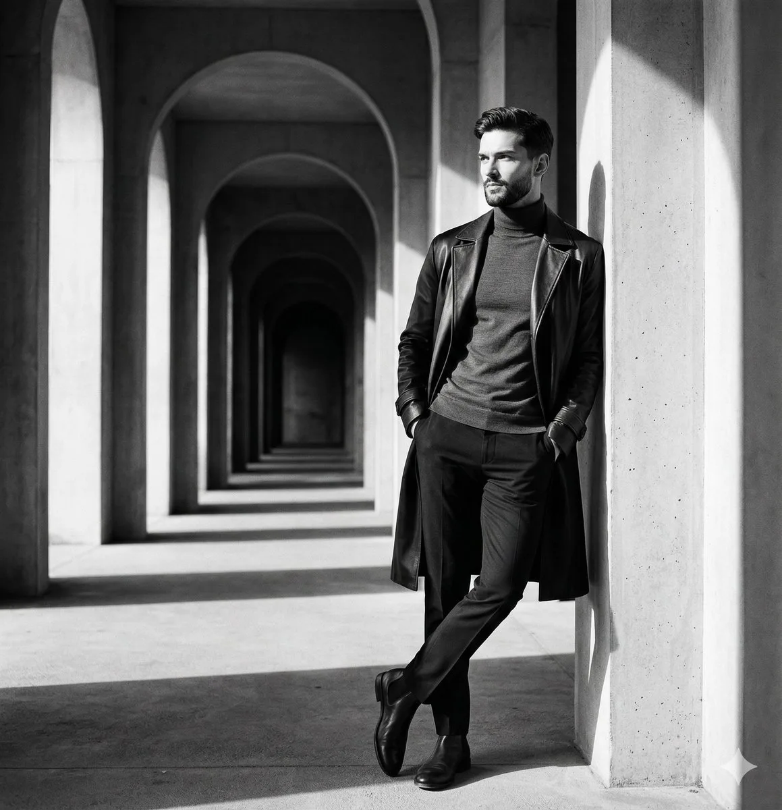

# Picts by AI — by @pictsbyai

[← Back to Community Examples](../../EXAMPLES.md) · Category: Photography · Model: `Nano Banana`

<a href="https://x.com/pictsbyai/status/2041191823180181722"></a>

Source: **[@pictsbyai on X](https://x.com/pictsbyai/status/2041191823180181722)** · Creator: [Picts by AI](https://x.com/pictsbyai)

## Prompt

```text
{
"metadata": {
"image_type": "photograph",
"primary_purpose": "editorial/portrait"
},
"composition": {
"rule_applied": "rule of thirds and one-point perspective",
"aspect_ratio": "2:3",
"layout": "asymmetric single subject with deep environmental context",
"focal_points": [
"Subject's brightly lit face on the right",
"The deep vanishing point of the colonnade on the left"
],
"visual_hierarchy": "Eye starts at the subject's face on the right due to contrast, travels down his dark silhouette, then follows the repeating diagonal lines of the pillars to the deep vanishing point on the far left.",
"balance": "asymmetric - the heavy, dark mass of the subject in the right foreground is balanced by the repeating, high-contrast structural elements receding into the deep background on the left"
},
"color_profile": {
"dominant_colors": [
{
"color": "Black",
"hex": "#0a0a0a",
"percentage": "45%",
"role": "primary subject clothing and deep architectural shadows"
},
{
"color": "Light Gray",
"hex": "#c8c8c8",
"percentage": "35%",
"role": "illuminated faces of the concrete pillars and floor"
},
{
"color": "Mid Gray",
"hex": "#6e6e6e",
"percentage": "20%",
"role": "shadow transitions and ambient background"
}
],
"color_palette": "monochromatic",
"temperature": "neutral",
"saturation": "black and white",
"contrast": "high contrast"
},
"lighting": {
"type": "natural window/archway light",
"source_count": "multiple sources - repeating archways on the left acting as large softboxes",
"direction": "90-degree side",
"directionality": "highly directional",
"quality": "soft light on the subject, hard geometric light on the architecture",
"intensity": "moody/high-key architectural highlights with low-key subject shadows",
"contrast_ratio": "high contrast (dramatic shadows)",
"mood": "dramatic/mysterious/sophisticated",
"shadows": {
"type": "harsh defined edges on structural elements, soft gradual edges on the subject's face",
"density": "deep black",
"placement": "cast across the floor, interior of the walkway, and the right side of the subject",
"length": "long - horizontal shadow projection across the corridor floor"
},
"highlights": {
"treatment": "preserved",
"placement": "on the left-facing planes of the pillars, the floor near the openings, and the subject's left cheek and nose"
},
"ambient_fill": "absent",
"light_temperature": "neutral"
},
"technical_specs": {
"medium": "digital photography",
"style": "realistic/editorial",
"texture": "smooth to slightly grainy",
"sharpness": "tack sharp on subject with natural lens fall-off in deep background",
"grain": "film grain - moderate level",
"depth_of_field": "deep - the subject is isolated by contrast, but the background architecture retains recognizable structure deep into the frame",
"perspective": "straight on at eye level with strong one-point vanishing perspective"
},
"artistic_elements": {
"genre": "portrait/editorial",
"influences": [
"Cinematic noir photography",
"Classic street and fashion photography",
"Brutalist architectural photography"
],
"mood": "sophisticated/dramatic/contemplative",
"atmosphere": "A quiet, isolated, and highly structured urban moment with a cinematic and slightly mysterious edge.",
"visual_style": "structured/geometric/clean"
},
"typography": {
"present": false,
"fonts": [],
"placement": "",
"integration": ""
},
"subject_analysis": {
"primary_subject": "Young Caucasian male wearing a dark turtleneck, long dark leather or heavy cotton trench coat, dark trousers, and dark Chelsea boots.",
"positioning": "right rule of thirds placement, anchoring the foreground",
"scale": "full body/environmental",
"interaction": "interacting with environment - leaning against architecture",
"facial_expression": {
"mouth": "neutral",
"smile_intensity": "no smile",
"eyes": "looking away to the right, out of frame",
"eyebrows": "relaxed",
"overall_emotion": "serious/contemplative/guarded",
"authenticity": "posed/editorial"
},
"hands_and_gestures": {
"left_hand": "hidden inside coat pocket",
"right_hand": "hidden inside coat pocket",
"finger_positions": "not visible",
"finger_interlacing": "none",
"hand_tension": "relaxed",
"interaction": "resting inside pockets, pulling the coat slightly back",
"naturalness": "deliberately posed but mimicking organic casual posture"
},
"body_positioning": {
"posture": "standing/leaning - left shoulder resting against the stone pillar",
"angle": "profile to 45 degree turn facing right",
"weight_distribution": "leaning right, resting weight on the pillar and left leg, right leg crossed over loosely",
"shoulders": "tilted due to the lean, left shoulder engaged with the wall"
}
},
"background": {
"setting_type": "outdoor/semi-enclosed architectural colonnade or covered walkway",
"spatial_depth": "deep - extreme vanishing point creating many layered planes of pillars",
"elements_detailed": [
{
"item": "Square architectural pillar 1 (foreground)",
"position": "right",
"distance": "foreground",
"size": "dominant",
"condition": "pristine/weathered",
"specific_features": "Smooth concrete or stone facing, acts as the structural prop for the subject"
},
{
"item": "Repeating architectural pillars (background)",
"position": "left",
"distance": "midground to deep background",
"size": "medium to small receding",
"condition": "pristine/weathered",
"specific_features": "Creating a rhythmic geometric pattern of light and shadow"
},
{
"item": "Ceiling coffers/beams",
"position": "top left",
"distance": "midground",
"size": "medium",
"condition": "pristine",
"specific_features": "Recessed rectangular ceiling details catching directional light"
}
],
"wall_surface": {
"material": "concrete/stone paneling",
"surface_treatment": "smooth with slight porous texture, finished architectural panels",
"texture": "slightly textured/matte",
"finish": "matte",
"color": "Neutral light gray to mid gray (in grayscale)",
"color_variation": "gradient due to strong lighting fall-off",
"features": "clean, visible horizontal and vertical panel seams/joints indicating modular construction",
"wear_indicators": "pristine institutional/civic architecture"
},
"floor_surface": {
"material": "concrete/stone",
"color": "Mid gray to dark gray in shadows",
"pattern": "solid with subtle smooth texture"
},
"objects_catalog": "Repeating concrete/stone structural pillars, paneled ceiling structure, solid paved floor",
"background_treatment": "sharp transitions into deep shadow, geometric, high contrast"
},
"generation_parameters": {
"prompts": [
"A cinematic black and white fashion editorial photograph of a young handsome man with wavy textured dark hair, wearing a black turtleneck and a long unbuttoned black leather trench coat. He is leaning his left shoulder against a large smooth concrete pillar in an endless architectural colonnade. He has both hands in his coat pockets, right leg crossed casually over the left. He is looking off-camera to the right with a serious, contemplative expression. The setting features strong one-point perspective with repeating archways receding deeply to the left. Highly directional, high-contrast natural light entering from the left, casting harsh geometric shadows on the concrete floor and walls, but providing soft dramatic light on the man's face. Shot on 35mm film, tack sharp subject, moody, sophisticated, striking geometry.",
"B&W photography, full body portrait of a man in a dark overcoat leaning on a structural column. Deep one-point perspective corridor on the left. High contrast, directional side lighting, distinct shadows, brutalist concrete architecture, moody, editorial fashion style."
],
"keywords": [
"black and white",
"editorial",
"trench coat",
"colonnade",
"one-point perspective",
"high contrast",
"chiaroscuro",
"cinematic",
"leaning",
"geometric shadows"
],
"technical_settings": "Camera: Full frame DSLR or 35mm film camera. Lens: 35mm to 50mm for natural perspective. Aperture: f/5.6 to f/8 to maintain focus on the subject while keeping the deep background structurally defined but slightly softer. Shutter speed: 1/250s or faster to prevent motion blur. ISO: 100-400 for clean shadows or natural film grain.",
"post_processing": "Black and white conversion with high contrast S-curve, deep crushed blacks, preserved highlights on the skin and structural edges, enhanced clarity on the concrete textures, and subtle film grain overlay."
}
}
```

## Try it

Paste the prompt into **[vinano.ai](https://vinano.ai?utm_source=github&utm_medium=readme&utm_campaign=awesome-image-video-prompts-updating&utm_content=x-page-try)** to generate your own version.

> The image and prompt belong to @pictsbyai ([original post](https://x.com/pictsbyai/status/2041191823180181722)) and are shown here with credit for reference. Creators can ask for changes or removal by opening an issue.
