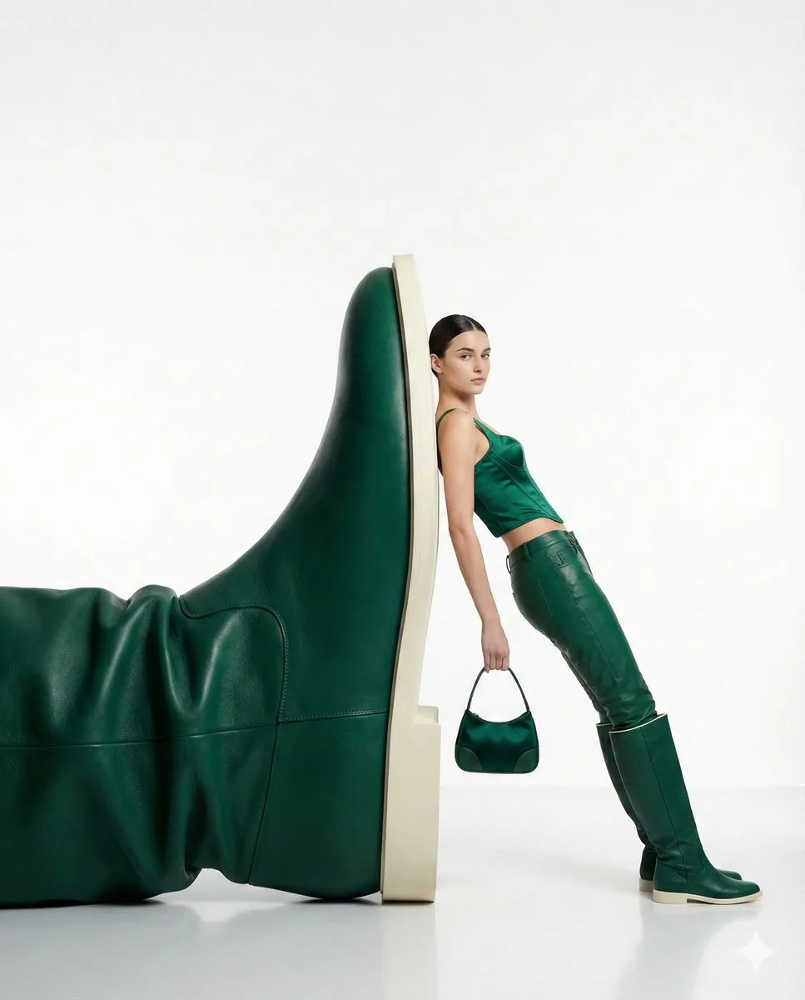

# Maercih — by @Maercihh

[← Back to Community Examples](../../EXAMPLES.md) · Category: Poster Design · Model: `Nano Banana`

<a href="https://x.com/Maercihh/status/2019648173652996217"></a>

Source: **[@Maercihh on X](https://x.com/Maercihh/status/2019648173652996217)** · Creator: [Maercih](https://x.com/Maercihh)

## Prompt

```text
{
  "style": "high-fashion editorial, minimalist surrealism",
  "subject": "a confident woman leaning casually against an oversized green leather boot sculpture",
  "pose": "relaxed yet powerful stance, body slightly angled, one arm holding a small handbag",
  "outfit": {
    "top": "emerald green fitted sleeveless top",
    "bottom": "matching green leather pants",
    "footwear": "knee-high green leather boots",
    "accessories": "small structured green handbag"
  },
  "composition": {
    "scale": "dramatic contrast between human figure and oversized object",
    "framing": "full body shot, centered subject with negative space",
    "background": "pure white seamless studio backdrop",
    "floor": "glossy white reflective surface"
  },
  "lighting": {
    "type": "soft studio lighting",
    "mood": "clean, premium, editorial",
    "shadows": "subtle, natural, controlled"
  },
  "color_palette": "monochromatic green tones with neutral white",
  "camera": {
    "angle": "eye-level",
    "lens": "85mm fashion lens",
    "depth_of_field": "sharp focus on subject, smooth background"
  },
  "vibe": "luxury fashion campaign, modern, confident, surreal elegance",
  "quality": "ultra-high resolution, crisp details, magazine-ready"
}
```

## Try it

Paste the prompt into **[vinano.ai](https://vinano.ai?utm_source=github&utm_medium=readme&utm_campaign=awesome-image-video-prompts-updating&utm_content=x-page-try)** to generate your own version.

> The image and prompt belong to @Maercihh ([original post](https://x.com/Maercihh/status/2019648173652996217)) and are shown here with credit for reference. Creators can ask for changes or removal by opening an issue.
