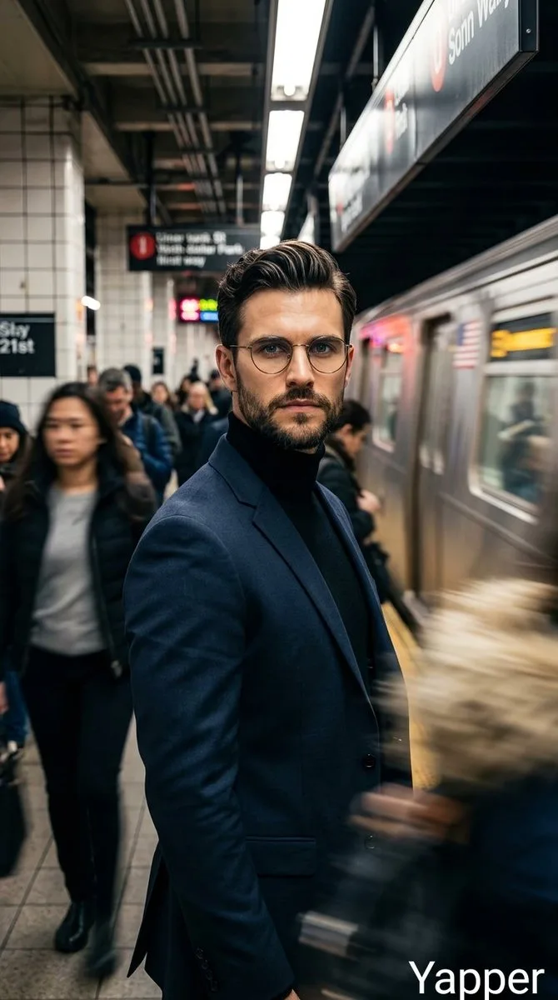

# Taaruk — by @Taaruk_

[← Back to Examples from X](../../EXAMPLES.md) · Category: Photography · Model: `Nano Banana`

<a href="https://x.com/Taaruk_/status/2033407780640698583"></a>

Original post: **[@Taaruk_ on X](https://x.com/Taaruk_/status/2033407780640698583)** · Creator: [Taaruk](https://x.com/Taaruk_)

## Prompt

```text
Cinematic portrait of a stylish man standing on a busy subway platform, wearing a dark tailored suit and black turtleneck with round glasses, serious confident expression, commuters rushing past creating motion blur around him, subway train beside the platform with metallic reflections, urban underground atmosphere, dramatic fluorescent subway lighting, shallow depth of field, subject sharply in focus while the crowd is blurred, modern thriller movie scene aesthetic, ultra-realistic photography, 85mm lens, high detail, 8K
```

## Try it

Paste the prompt into **[vinano.ai](https://vinano.ai?utm_source=github&utm_medium=readme&utm_campaign=awesome-image-video-prompts-updating&utm_content=x-page-try)** to generate your own version.

> The image and prompt belong to [@Taaruk_](https://x.com/Taaruk_) and are shown here with credit for reference. Creators can ask for changes or removal by opening an issue.
