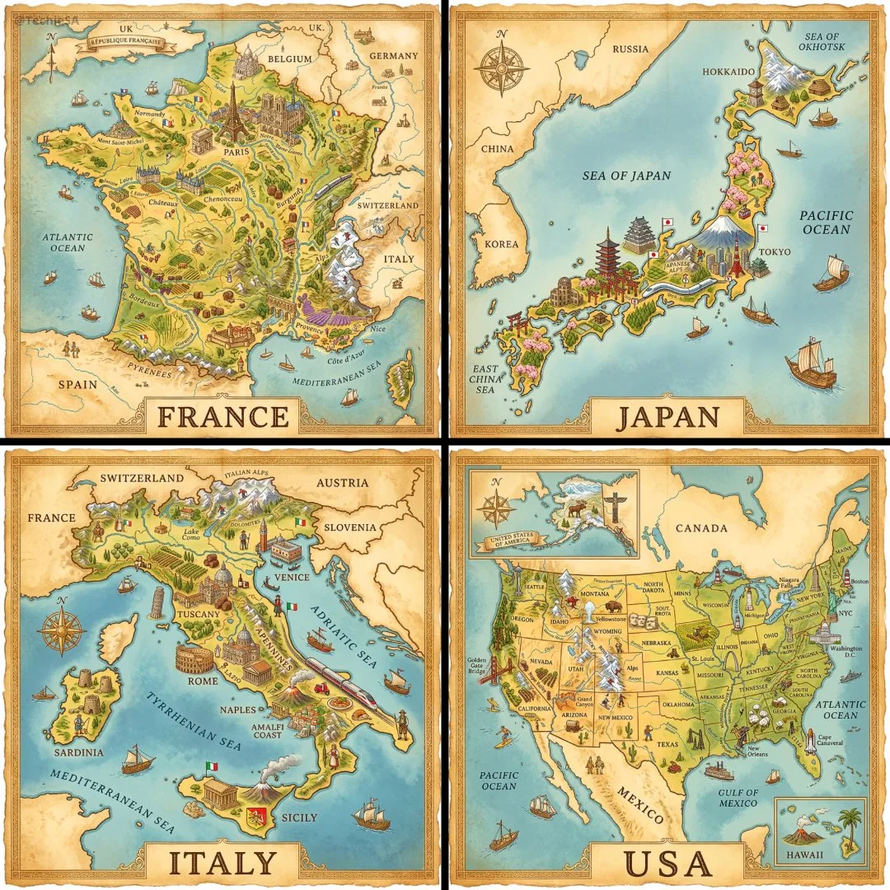

# TechieSA — by @TechieBySA

[← Back to Examples from X](../../EXAMPLES.md) · Category: Illustration & 3D · Model: `Nano Banana`

<a href="https://x.com/TechieBySA/status/2037508886639366409"></a>

Original post: **[@TechieBySA on X](https://x.com/TechieBySA/status/2037508886639366409)** · Creator: [TechieSA](https://x.com/TechieBySA)

## Prompt

```text
A hand-painted isometric bird’s-eye view illustration of [COUNTRY] in a vintage map style, featuring iconic landmarks and natural scenery unique to the country. The landscape should blend seamlessly with a parchment-colored map background, and include detailed miniature architecture, cultural symbols, and geographical elements. The country name '[COUNTRY]' should appear in bold serif text below the scene. Maintain warm, earthy tones and soft lighting for a classic, illustrated map feel. 1080x1080 dimension
```

## Try it

Paste the prompt into **[vinano.ai](https://vinano.ai?utm_source=github&utm_medium=readme&utm_campaign=awesome-image-video-prompts-updating&utm_content=x-page-try)** to generate your own version.

> The image and prompt belong to [@TechieBySA](https://x.com/TechieBySA) and are shown here with credit for reference. Creators can ask for changes or removal by opening an issue.
