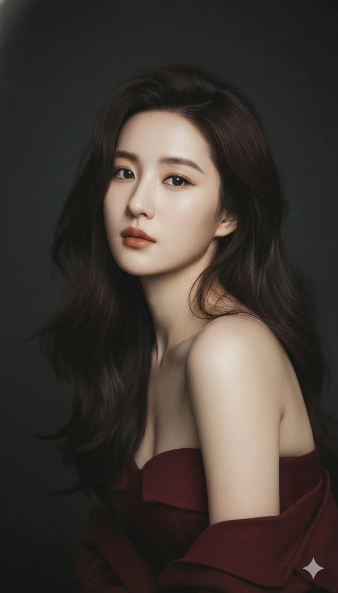

# Adam也叫吉米 — by @Adam38363368936

[← Back to Community Examples](../../EXAMPLES.md) · Category: Photography · Model: `Nano Banana`

<a href="https://x.com/Adam38363368936/status/2016087801759203335"></a>

Source: **[@Adam38363368936 on X](https://x.com/Adam38363368936/status/2016087801759203335)** · Creator: [Adam也叫吉米](https://x.com/Adam38363368936)

## Prompt

```text
Create a melancholic and cinematic portrait photography. A young woman with clear, fair skin and light makeup. Warm, natural lip color. Deep brown hair with a fluffy texture. A calm and confident expression. Wearing a wine-red top to showcase elegance. A dark, minimalist background fading to black. Soft, diffused front lighting, gentle shadows, subtle film grain, organic color grading, shallow depth of field, and high-end editing texture. Use the facial features of the reference subject without any alterations.
```

## Try it

Paste the prompt into **[vinano.ai](https://vinano.ai?utm_source=github&utm_medium=readme&utm_campaign=awesome-image-video-prompts-updating&utm_content=x-page-try)** to generate your own version.

> The image and prompt belong to @Adam38363368936 ([original post](https://x.com/Adam38363368936/status/2016087801759203335)) and are shown here with credit for reference. Creators can ask for changes or removal by opening an issue.
