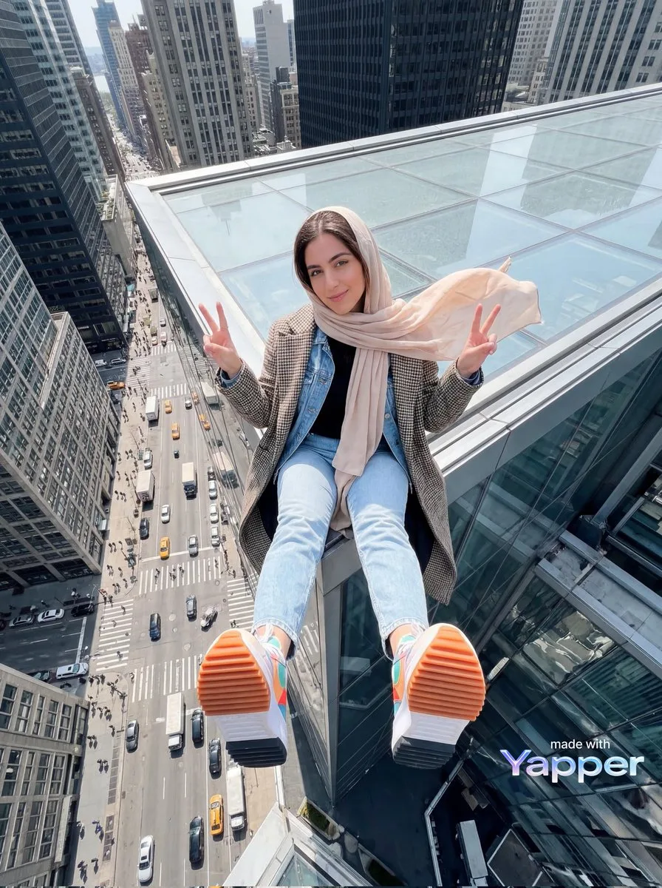

# 𝗦𝗮𝗻𝗶𝗮 — by @saniaspeaks_

[← Back to Examples from X](../../EXAMPLES.md) · Category: Photography · Model: `Nano Banana`

<a href="https://x.com/saniaspeaks_/status/2033772942799343930"></a>

Original post: **[@saniaspeaks_ on X](https://x.com/saniaspeaks_/status/2033772942799343930)** · Creator: [𝗦𝗮𝗻𝗶𝗮](https://x.com/saniaspeaks_)

## Prompt

```text
{
  "image_generation": {
    "subject": {
      "description": "young woman sitting at the edge of a skyscraper rooftop with a dramatic city view below",
      "pose": "sitting with legs extended toward the camera, both hands raised making peace signs",
      "expression": "playful confident smile",
      "gaze": "looking directly at the camera"
    },
    "appearance": {
      "hair": {
        "color": "dark brown",
        "style": "covered with a light beige headscarf flowing in the wind"
      },
      "skin": {
        "tone": "fair natural skin tone",
        "texture": "smooth realistic skin"
      },
      "makeup": "light natural makeup"
    },
    "outfit": {
      "outerwear": "long patterned coat",
      "inner_layer": "black top with denim jacket",
      "bottom": "light blue jeans",
      "footwear": "colorful sneakers with orange soles"
    },
    "environment": {
      "setting": "urban city high-rise rooftop",
      "background_elements": [
        "busy city street far below",
        "cars and taxis on the road",
        "tall buildings on both sides",
        "glass rooftop surface"
      ],
      "time_of_day": "daytime"
    },
    "lighting": {
      "type": "natural daylight",
      "direction": "soft overhead light",
      "effect": "bright urban lighting with balanced shadows"
    },
    "camera": {
      "angle": "extreme high angle / top-down perspective",
      "framing": "full body with exaggerated perspective",
      "lens": "wide-angle lens",
      "depth_of_field": "deep focus showing detailed city below"
    },
    "aesthetic": {
      "style": "urban lifestyle photography",
      "vibe": "adventurous bold city energy",
      "color_palette": "vibrant city tones with pops of orange and blue"
    },
    "effects": {
      "grading": "cinematic vibrant color grading",
      "sharpness": "high detail with slight depth exaggeration"
    },
    "quality": {
      "resolution": "high resolution",
      "render": "photorealistic",
      "details": "sharp textures with strong perspective depth"
    }
  }
}
```

## Try it

Paste the prompt into **[vinano.ai](https://vinano.ai?utm_source=github&utm_medium=readme&utm_campaign=awesome-image-video-prompts-updating&utm_content=x-page-try)** to generate your own version.

> The image and prompt belong to [@saniaspeaks_](https://x.com/saniaspeaks_) and are shown here with credit for reference. Creators can ask for changes or removal by opening an issue.
