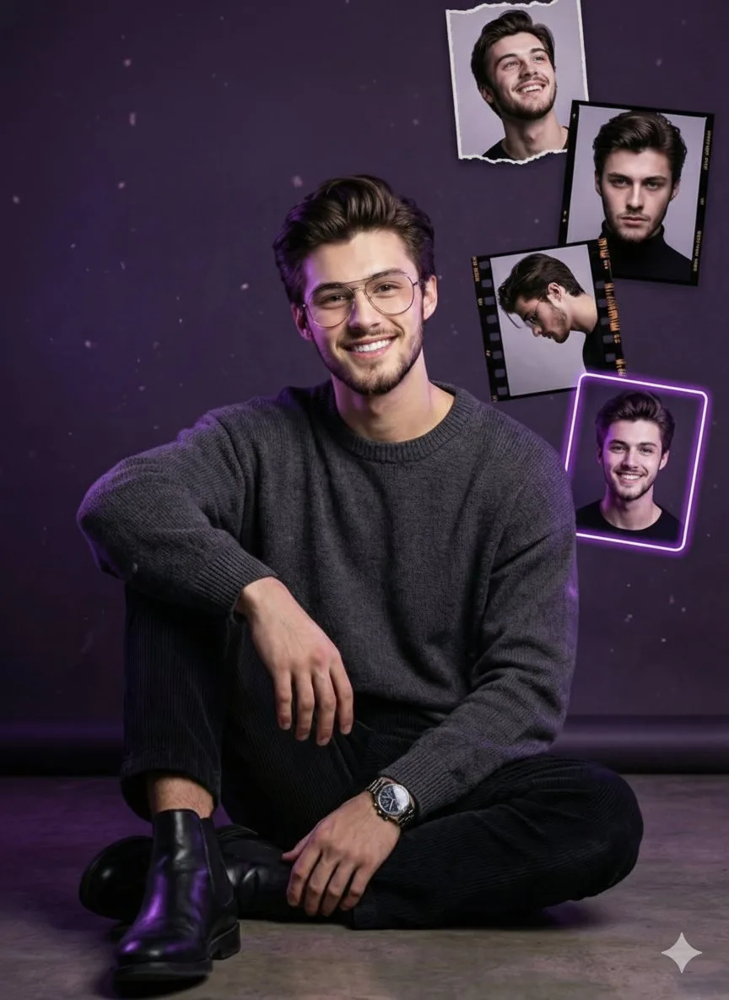

# Taaruk — by @Taaruk_

[← Back to Community Examples](../../EXAMPLES.md) · Category: Photography · Model: `Nano Banana`

<a href="https://x.com/Taaruk_/status/2010626509690831267"></a>

Source: **[@Taaruk_ on X](https://x.com/Taaruk_/status/2010626509690831267)** · Creator: [Taaruk](https://x.com/Taaruk_)

## Prompt

```text
{
  "Objective": "Create a stylish, cinematic birthday-themed studio portrait with a modern celebratory poster aesthetic",
  "PersonaDetails": {
    "Subject": {
      "Type": "Young man",
      "Pose": "Sitting casually on the floor",
      "Expression": "Confident, friendly smile",
      "Gaze": "Looking directly at the camera",
      "Accessories": [
        "Glasses",
        "Wristwatch"
      ]
    }
  },
  "Wardrobe": {
    "Top": "Dark grey sweater",
    "Bottom": "Black trousers",
    "Footwear": "Black leather boots",
    "Style": "Clean, modern, understated"
  },
  "SceneDescription": {
    "Environment": "Studio setting",
    "Background": {
      "Color": "Deep purple",
      "Details": "Subtle glowing particles floating in the background"
    }
  },
  "GraphicElements": {
    "Typography": {
      "Text": "Happy Birthday",
      "Style": "Neon typography",
      "Color": "Soft purple and white glow",
      "Placement": "Top corner of the composition"
    },
    "FloatingFrames": {
      "Description": "Multiple framed portrait snapshots of the same person",
      "Variations": [
        "Different poses and moods",
        "Film negative–style frames",
        "Neon-outlined light frames"
      ],
      "Arrangement": "Floating around the subject with balanced spacing"
    }
  },
  "Composition": {
    "Framing": "Medium full-body portrait",
    "Layout": "Centered subject with surrounding floating elements",
    "Balance": "Clean, poster-style composition",
    "DepthOfField": "Shallow depth of field with layered depth"
  },
  "LightingAndColor": {
    "LightingStyle": "Cinematic studio lighting",
    "RimLight": "Soft purple rim light for edge separation",
    "Contrast": "High contrast with controlled highlights",
    "ColorPalette": [
      "Deep purple",
      "Black",
      "Soft white highlights"
    ]
  },
  "ArtDirection": {
    "Style": "Modern celebratory poster",
    "Aesthetic": "Stylish, cinematic, social-media–ready",
    "DetailLevel": "Ultra-detailed textures and crisp edges",
    "RealismLevel": "Photorealistic with graphic design overlays"
  },
  "PhotographyStyle": {
    "Genre": "Professional studio portrait photography",
    "Finish": "High-end, polished, digital poster look",
    "Resolution": "Ultra-high resolution, sharp focus"
  },
  "Mood": {
    "Tone": "Celebratory, confident, modern",
    "Energy": "Positive, stylish, personal"
  },
  "NegativePrompt": [
    "messy composition",
    "low resolution",
    "flat lighting",
    "oversaturated neon",
    "cartoon style",
    "blurry text",
    "cluttered background"
  ],
  "ResponseFormat": {
    "Type": "Single composite image",
    "Orientation": "Portrait",
    "AspectRatio": "4:5",
    "UseCase": [
      "Social media post",
      "Birthday poster",
      "Digital celebration graphic"
    ]
  }
}
```

## Try it

Paste the prompt into **[vinano.ai](https://vinano.ai?utm_source=github&utm_medium=readme&utm_campaign=awesome-image-video-prompts-updating&utm_content=x-page-try)** to generate your own version.

> The image and prompt belong to @Taaruk_ ([original post](https://x.com/Taaruk_/status/2010626509690831267)) and are shown here with credit for reference. Creators can ask for changes or removal by opening an issue.
