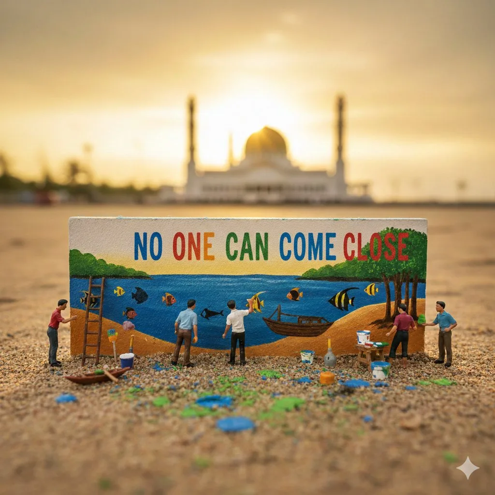

# Sharon Riley — by @Just_sharon7

[← Back to Examples from X](../../EXAMPLES.md) · Category: Illustration & 3D · Model: `Nano Banana`

<a href="https://x.com/Just_sharon7/status/2011978683230347749"></a>

Original post: **[@Just_sharon7 on X](https://x.com/Just_sharon7/status/2011978683230347749)** · Creator: [Sharon Riley](https://x.com/Just_sharon7)

## Prompt

```text
{
  "scene": {
    "description": "Artistic miniature diorama of youthful figurines collaboratively painting a vibrant environmental mural on a small outdoor wall near Gedung Sate, Bandung.",
    "location": "Near Gedung Sate, Bandung, Indonesia",
    "environment": "Urban cultural landmark setting with a cozy, handcrafted miniature scale"
  },
  "subjects": {
    "characters": "Miniature youth figurines",
    "actions": [
      "painting a large colorful mural",
      "climbing tiny ladders",
      "holding paint brushes and buckets",
      "splashing paint playfully"
    ],
    "expressions": "Energetic, joyful, creative"
  },
  "mural_details": {
    "theme": "Environmental awareness and positivity",
    "elements": [
      "green mountains",
      "lush trees",
      "bicycles symbolizing eco-friendly transport",
      "clean flowing rivers"
    ],
    "text": "You're the best, Sharon"
  },
  "props": {
    "items": [
      "tiny paint buckets",
      "mini ladders",
      "small paint brushes",
      "paint splashes on ground and wall"
    ]
  },
  "style": {
    "art_form": "Miniature diorama",
    "photography": "Cinematic macro photography",
    "detail_level": "Highly detailed textures and figures"
  },
  "lighting": {
    "type": "Warm, soft lighting",
    "mood": "Bright, cheerful, uplifting"
  },
  "camera": {
    "depth_of_field": "Shallow depth of field",
    "focus": "Sharp focus on figurines and mural"
  },
  "color_palette": {
    "tones": [
      "Bright",
      "Cheerful",
      "Vivid"
    ]
  },
  "render_settings": {
    "aspect_ratio": "4:5",
    "quality": 2,
    "stylization": "2/5"
  }
}
```

## Try it

Paste the prompt into **[vinano.ai](https://vinano.ai?utm_source=github&utm_medium=readme&utm_campaign=awesome-image-video-prompts-updating&utm_content=x-page-try)** to generate your own version.

> The image and prompt belong to [@Just_sharon7](https://x.com/Just_sharon7) and are shown here with credit for reference. Creators can ask for changes or removal by opening an issue.
