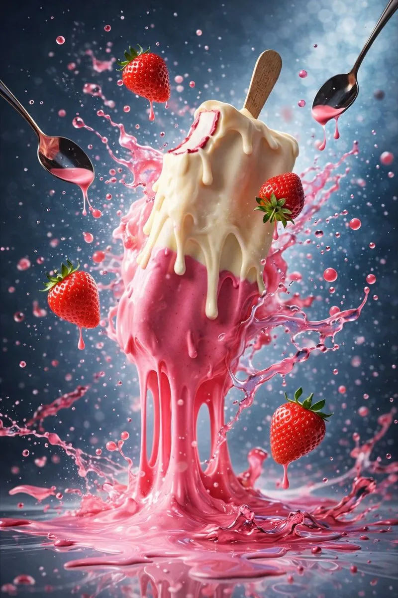

# ShaHid WaNii — by @meng_dagg695

[← Back to Community Examples](../../EXAMPLES.md) · Category: Food & Drink · Model: `Nano Banana`

<a href="https://x.com/meng_dagg695/status/2016534463459832095"></a>

Source: **[@meng_dagg695 on X](https://x.com/meng_dagg695/status/2016534463459832095)** · Creator: [ShaHid WaNii](https://x.com/meng_dagg695)

## Prompt

```text
{
  "master_prompt": {
    "global_settings": {
      "resolution": "8K",
      "aspect_ratio": "3:4",
      "render_style": "hyper-realistic AI-generated food photography",
      "focus": "extreme detail, sharp textures, dynamic motion, cinematic lighting",
      "depth_of_field": "shallow with foreground focus",
      "noise": "none",
      "artifacts": "none"
    },

    "Module_1_Image_Style": {
      "subject": "Single ice cream cone standing upright",
      "ice_cream": {
        "top": "vanilla soft-serve swirl",
        "toppings": [
          "two whole strawberries",
          "one chocolate wafer roll",
          "one chocolate square partially embedded"
        ],
        "sauces": [
          "dark chocolate sauce dripping",
          "green pistachio-like glaze dripping"
        ]
      },
      "cone": {
        "type": "waffle cone",
        "texture": "crisp grid pattern",
        "condition": "sauce dripping down the cone and pooling at the base"
      },
      "motion_elements": {
        "floating": [
          "small colorful candy spheres",
          "liquid droplets suspended mid-air"
        ],
        "splashes": "sauce splashes around cone base"
      },
      "background": {
        "style": "soft bokeh",
        "colors": [
          "orange",
          "green",
          "purple",
          "gold"
        ],
        "lighting": "warm, cinematic, high contrast"
      }
    },

    "Module_2_Image_Style": {
      "subject": "Strawberry ice cream bar on wooden stick, tilted diagonally",
      "ice_cream": {
        "base": "pink strawberry ice cream",
        "top_layer": "white cream layer",
        "toppings": [
          "sliced strawberries embedded",
          "whole strawberries floating"
        ]
      },
      "stick": {
        "material": "wood",
        "text": "ai ice",
        "orientation": "visible, centered"
      },
      "motion_elements": {
        "liquid": "cream and strawberry liquid splashing outward",
        "floating_objects": [
          "metal spoons with pink liquid",
          "whole strawberries",
          "mint leaves",
          "droplets"
        ]
      },
      "background": {
        "style": "soft gradient with bokeh particles",
        "colors": [
          "peach",
          "blue",
          "cream"
        ],
        "lighting": "bright highlights with soft shadows"
      }
    },

    "Module_3_Image_Style": {
      "subject": "Spherical scoop composition of strawberry and vanilla ice cream",
      "ice_cream": {
        "layers": [
          "pink strawberry scoop",
          "white vanilla scoop"
        ],
        "embedded_elements": [
          "halved strawberries",
          "whole strawberries"
        ]
      },
      "motion_elements": {
        "liquid": "pink strawberry liquid splashing and dripping downward",
        "floating_objects": [
          "blueberries",
          "strawberries",
          "liquid droplets"
        ],
        "utensils": "metal spoons suspended mid-air with liquid"
      },
      "surface_detail": {
        "texture": "smooth ice cream with visible melting edges",
        "droplets": "high-gloss liquid beads"
      },
      "background": {
        "style": "cool-toned blur",
        "colors": [
          "light blue",
          "gray"
        ],
        "lighting": "clean studio lighting with specular highlights"
      }
    }
```

## Try it

Paste the prompt into **[vinano.ai](https://vinano.ai?utm_source=github&utm_medium=readme&utm_campaign=awesome-image-video-prompts-updating&utm_content=x-page-try)** to generate your own version.

> The image and prompt belong to @meng_dagg695 ([original post](https://x.com/meng_dagg695/status/2016534463459832095)) and are shown here with credit for reference. Creators can ask for changes or removal by opening an issue.
