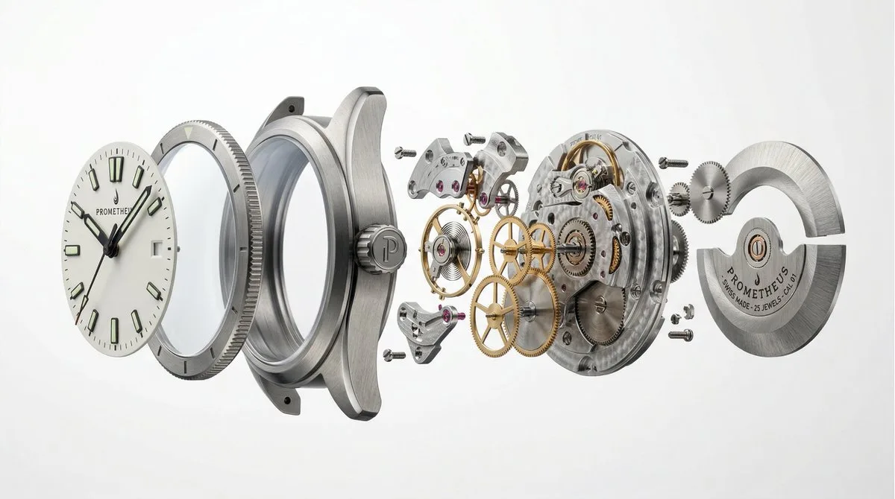

# Alexandra Aisling — by @AllaAisling

[← Back to Community Examples](../../EXAMPLES.md) · Category: Illustration & 3D · Model: `Nano Banana`

<a href="https://x.com/AllaAisling/status/2028956048531288229"></a>

Source: **[@AllaAisling on X](https://x.com/AllaAisling/status/2028956048531288229)** · Creator: [Alexandra Aisling](https://x.com/AllaAisling)

## Prompt

```text
Prompt Studio: Minimalist Luxury Product Design with Nano Banana 2 in Firefly

Pristine product visualization, [object] in [material], deconstructed floating parts suspended in a precision-aligned engineering sequence, pure white gradient void with subtle depth falloff, sculptural studio lighting with sharp rim highlights, mirror-polished and matte surface contrast, ultra-macro lens revealing microscopic [surface detail] and internal [component detail], shallow depth of field isolating the core components, minimalist Braun meets Leica aesthetic, heroic product scale presence, product photography.

Check ALTs for ideas 👇 @AdobeFirefly
```

## Try it

Paste the prompt into **[vinano.ai](https://vinano.ai?utm_source=github&utm_medium=readme&utm_campaign=awesome-image-video-prompts-updating&utm_content=x-page-try)** to generate your own version.

> The image and prompt belong to @AllaAisling ([original post](https://x.com/AllaAisling/status/2028956048531288229)) and are shown here with credit for reference. Creators can ask for changes or removal by opening an issue.
