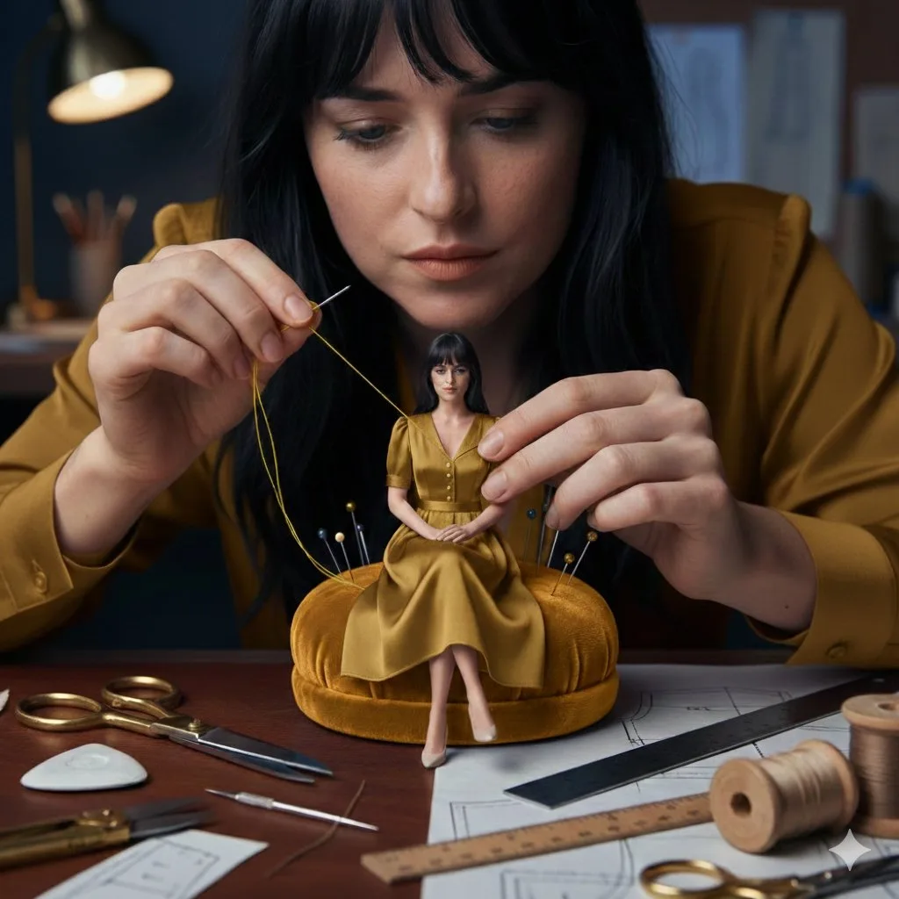

# Synthia — by @AIwithSynthia

[← Back to Community Examples](../../EXAMPLES.md) · Category: Photography · Model: `Nano Banana`

<a href="https://x.com/AIwithSynthia/status/2024111444334407809"></a>

Source: **[@AIwithSynthia on X](https://x.com/AIwithSynthia/status/2024111444334407809)** · Creator: [Synthia](https://x.com/AIwithSynthia)

## Prompt

```text
A cinematic fashion studio scene of a woman hand-sewing a miniature dress worn by a tiny version of herself seated on a pin cushion.
She uses a fine needle and silk thread, concentrating intensely as fabric tension is adjusted.
The miniature garment features perfectly scaled seams, buttons, and lifelike fabric weight in it .
Workbench filled with miniature scissors, chalk, rulers, pattern papers, and thread reels.
Warm cinematic lighting reveals textile grain, skin pores, and metal reflections.
Macro depth of field, fashion editorial composition, ultra-photoreal realism, 8K quality.

Style: cinematic miniature tailoring realism, no cartoon, no CGI
```

## Try it

Paste the prompt into **[vinano.ai](https://vinano.ai?utm_source=github&utm_medium=readme&utm_campaign=awesome-image-video-prompts-updating&utm_content=x-page-try)** to generate your own version.

> The image and prompt belong to @AIwithSynthia ([original post](https://x.com/AIwithSynthia/status/2024111444334407809)) and are shown here with credit for reference. Creators can ask for changes or removal by opening an issue.
