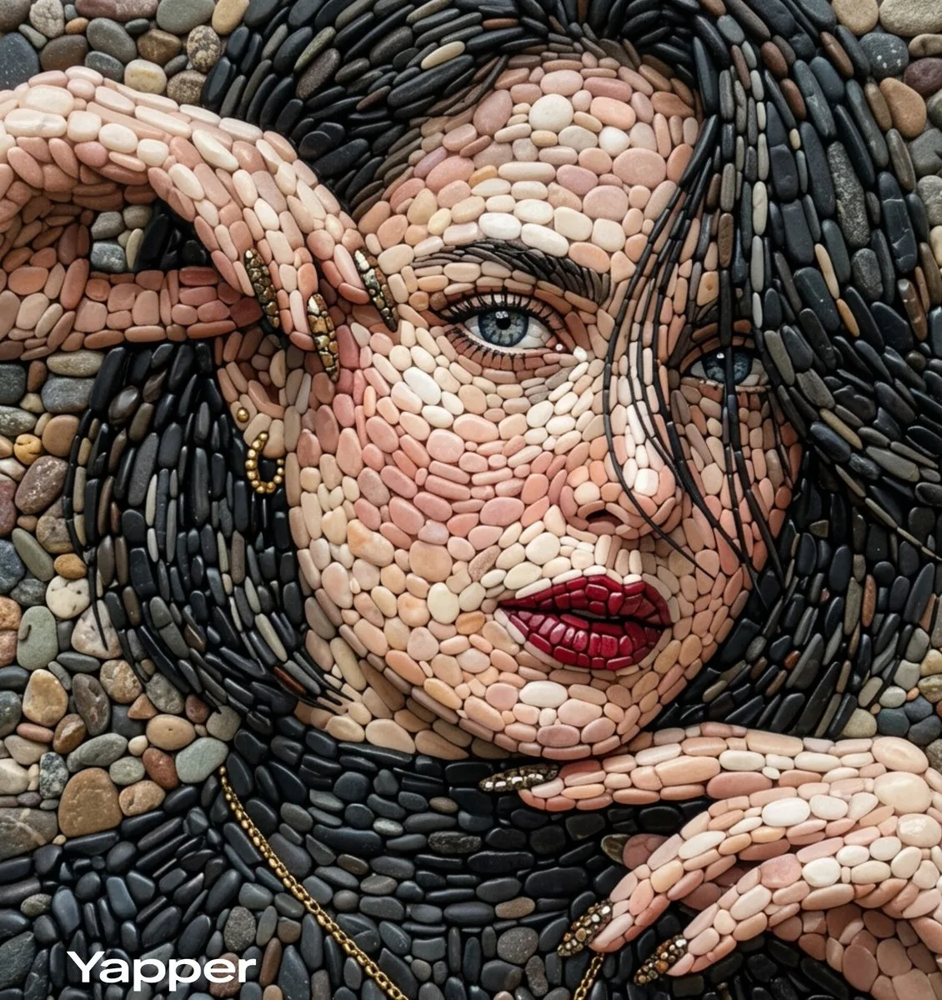

# Synthia — by @AIwithSynthia

[← Back to Examples from X](../../EXAMPLES.md) · Category: Illustration & 3D · Model: `Nano Banana`

<a href="https://x.com/AIwithSynthia/status/2031520039850094952"></a>

Original post: **[@AIwithSynthia on X](https://x.com/AIwithSynthia/status/2031520039850094952)** · Creator: [Synthia](https://x.com/AIwithSynthia)

## Prompt

```text
A highly detailed pebble mosaic portrait of a beautiful woman, where the entire image is constructed from thousands of smooth natural stones and pebbles. The pebbles vary in size and color to form realistic facial features, hair, skin tones, and clothing patterns. The woman has long flowing hair and is wearing a richly patterned red traditional dress. The background is also composed of carefully arranged river stones creating a textured mosaic wall. Ultra-detailed stone texture, gemini natural earthy colors, soft lighting, artistic stone mosaic craftsmanship, gemini photorealistic composition, 8k resolution, intricate pebble placement, handcrafted mosaic art style.
```

## Try it

Paste the prompt into **[vinano.ai](https://vinano.ai?utm_source=github&utm_medium=readme&utm_campaign=awesome-image-video-prompts-updating&utm_content=x-page-try)** to generate your own version.

> The image and prompt belong to [@AIwithSynthia](https://x.com/AIwithSynthia) and are shown here with credit for reference. Creators can ask for changes or removal by opening an issue.
