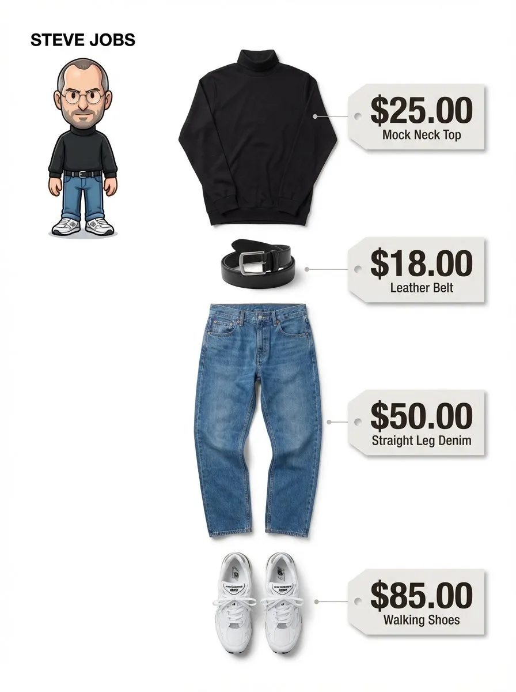

# TechieSA — by @TechieBySA

[← Back to Examples from X](../../EXAMPLES.md) · Category: Product & Brand · Model: `Nano Banana`

<a href="https://x.com/TechieBySA/status/2017599847025520679"></a>

Original post: **[@TechieBySA on X](https://x.com/TechieBySA/status/2017599847025520679)** · Creator: [TechieSA](https://x.com/TechieBySA)

## Prompt

```text
Create a clean, minimalist fashion infographic from an uploaded reference photo of a person.

Extract the outfit worn by the person and present only the clothing and accessories, with no body, no mannequin, and no inflated or air-filled shapes.

Each clothing item should appear naturally relaxed, as if laid flat on a clean studio surface or gently suspended by gravity, with realistic folds, creases, and fabric drape (hoodies slightly collapsed, jackets softly folded, pants relaxed, shoes resting naturally).

Arrange the outfit pieces in a top-to-bottom vertical order (headwear → outerwear → top → bottoms → footwear → accessories), spaced clearly in a calm exploded-view layout.

Character Illustration

In the top-left corner, include a small stylized cartoon / anime-inspired figure of the person from the uploaded reference image:
•Wearing the same outfit shown in the breakdown
•Standing straight like a collectible action figure
•Slightly puffy proportions (soft premium vinyl-toy feel)
•Clean shading, minimal facial detail

Above the character, display the person’s name:
•Clearly readable size
•Black, clean modern sans-serif typography
•No background box

Item Labels & Price Tags

For each clothing item, include:
•A thin, clean connector line pointing to the item
•A large, highly readable retail-style price tag

Each price tag must:
•Display the price as the primary visual element (large, bold, instantly readable)
•Include the item name in smaller secondary text
•Be visually attached to the connector line

Price tag design:
•Rectangular or rounded retail tag style
•Light neutral background (off-white or light gray)
•Dark high-contrast text
•Subtle shadow for depth
•Price text significantly larger than all other tag text

Do not include brand names.

Visual Style
•Pure white studio background
•Soft, even lighting with subtle contact shadows
•Editorial fashion-magazine infographic aesthetic
•Realistic fabric colors and textures
•Clean modern sans-serif typography

Composition
•Centered vertical outfit layout
•Character illustration anchored in the top-left corner
•Strong readability of prices at first glance
•Balanced negative space, uncluttered
•No props, no decorative elements

Output
Ultra-sharp, high-end fashion breakdown
Social-feed optimized
No watermark.
```

## Try it

Paste the prompt into **[vinano.ai](https://vinano.ai?utm_source=github&utm_medium=readme&utm_campaign=awesome-image-video-prompts-updating&utm_content=x-page-try)** to generate your own version.

> The image and prompt belong to [@TechieBySA](https://x.com/TechieBySA) and are shown here with credit for reference. Creators can ask for changes or removal by opening an issue.
