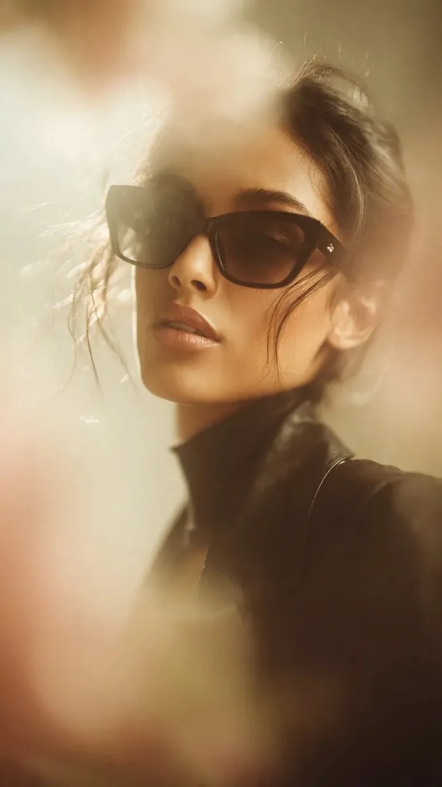

# Kashberg — by @Kashberg_0

[← Back to Examples from X](../../EXAMPLES.md) · Category: Photography · Model: `Nano Banana`

<a href="https://x.com/Kashberg_0/status/2027738988673700214"></a>

Original post: **[@Kashberg_0 on X](https://x.com/Kashberg_0/status/2027738988673700214)** · Creator: [Kashberg](https://x.com/Kashberg_0)

## Prompt

```text
Ultra-realistic cinematic fashion portrait of a stylish woman wearing oversized black cat-eye sunglasses, soft warm golden sunlight, hazy foreground blur creating dreamy depth, shallow depth of field, glowing skin, natural makeup, glossy nude lips, loose messy updo hairstyle with soft strands falling, black high-neck outfit, luxury editorial vibe, shot through translucent fabric for soft diffusion, 85mm lens, f/1.8, creamy bokeh, golden hour lighting, warm beige color grading, high detail, photorealistic, Vogue style photography, soft focus edges, elegant and minimal background
```

## Try it

Paste the prompt into **[vinano.ai](https://vinano.ai?utm_source=github&utm_medium=readme&utm_campaign=awesome-image-video-prompts-updating&utm_content=x-page-try)** to generate your own version.

> The image and prompt belong to [@Kashberg_0](https://x.com/Kashberg_0) and are shown here with credit for reference. Creators can ask for changes or removal by opening an issue.
