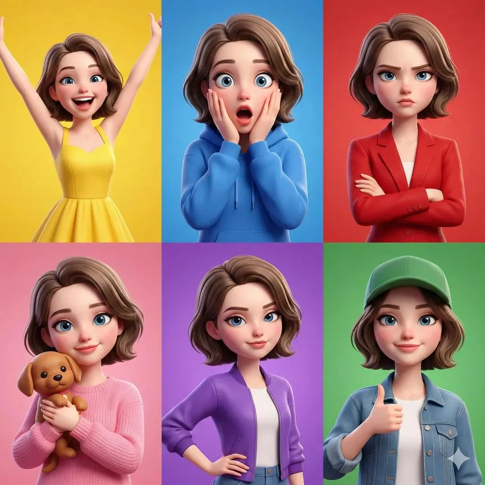

# Taaruk — by @Taaruk_

[← Back to Community Examples](../../EXAMPLES.md) · Category: Illustration & 3D · Model: `Nano Banana`

<a href="https://x.com/Taaruk_/status/2023035676791603643"></a>

Source: **[@Taaruk_ on X](https://x.com/Taaruk_/status/2023035676791603643)** · Creator: [Taaruk](https://x.com/Taaruk_)

## Prompt

```text
3D Pixar-style animated girl shown in a 6-panel grid, same character with short brown hair and big blue eyes, different emotions (happy, shocked, angry, caring, confident, thumbs up), colorful solid backgrounds (yellow, blue, red, pink, purple, green), soft studio lighting, smooth 3D render, vibrant colors, ultra-detailed, 4K, animated movie quality.
```

## Try it

Paste the prompt into **[vinano.ai](https://vinano.ai?utm_source=github&utm_medium=readme&utm_campaign=awesome-image-video-prompts-updating&utm_content=x-page-try)** to generate your own version.

> The image and prompt belong to @Taaruk_ ([original post](https://x.com/Taaruk_/status/2023035676791603643)) and are shown here with credit for reference. Creators can ask for changes or removal by opening an issue.
