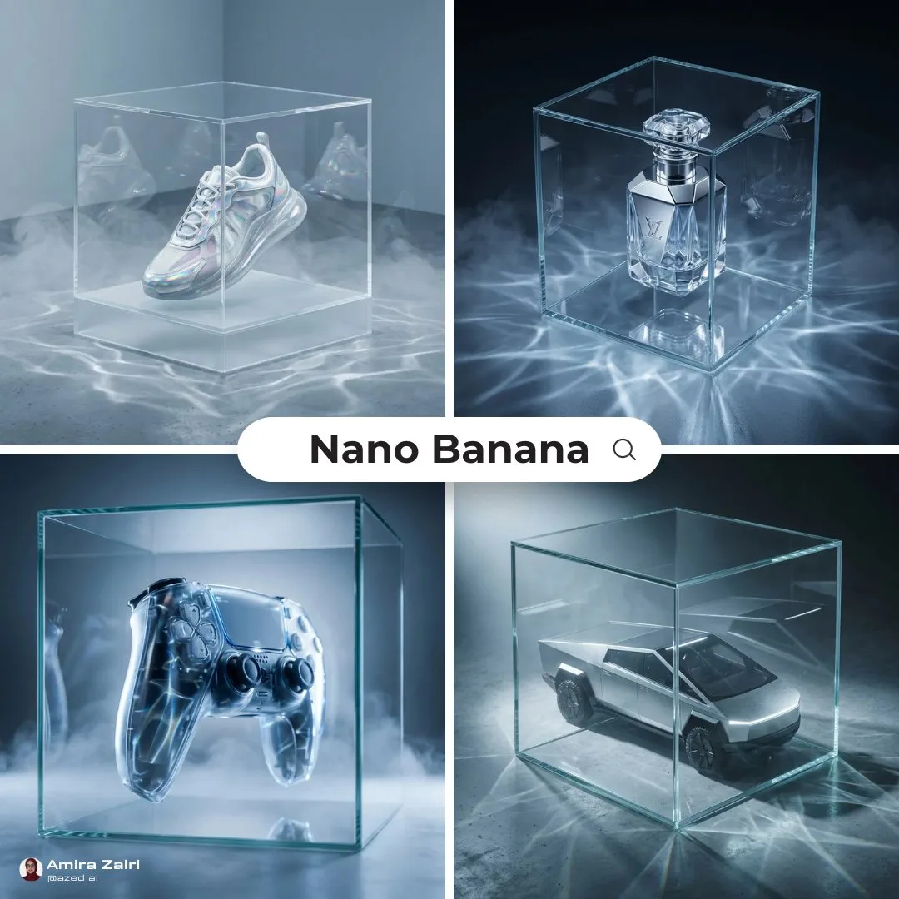

# Amira Zairi — by @azed_ai

[← Back to Examples from X](../../EXAMPLES.md) · Category: Poster Design · Model: `Nano Banana`

<a href="https://x.com/azed_ai/status/2020498871894573126"></a>

Original post: **[@azed_ai on X](https://x.com/azed_ai/status/2020498871894573126)** · Creator: [Amira Zairi](https://x.com/azed_ai)

## Prompt

```text
[product], futuristic high-end ad, transparent glass cube enclosure, caustic light patterns on surface, minimal composition, cool studio lighting, subtle fog, sharp reflections, ultra-realistic, macro product photography, 100mm lens look, f/8, 8k, 1:1
```

## Try it

Paste the prompt into **[vinano.ai](https://vinano.ai?utm_source=github&utm_medium=readme&utm_campaign=awesome-image-video-prompts-updating&utm_content=x-page-try)** to generate your own version.

> The image and prompt belong to [@azed_ai](https://x.com/azed_ai) and are shown here with credit for reference. Creators can ask for changes or removal by opening an issue.
