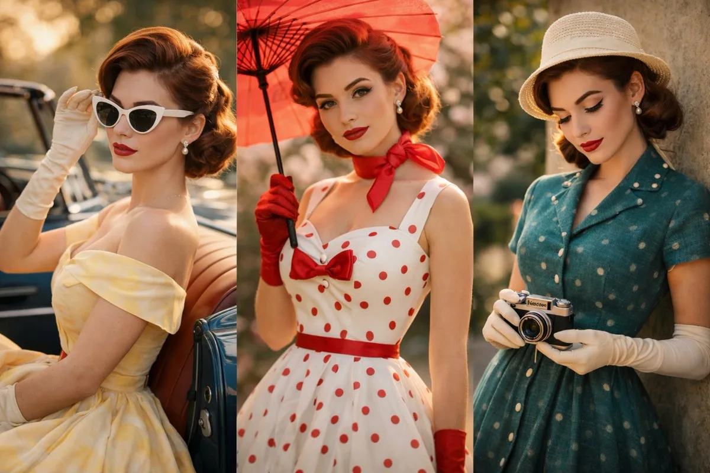

# Cherry 2.O — by @Mind_Boticni

[← Back to Examples from X](../../EXAMPLES.md) · Category: Photography · Model: `Nano Banana`

<a href="https://x.com/Mind_Boticni/status/2018167069343416703"></a>

Original post: **[@Mind_Boticni on X](https://x.com/Mind_Boticni/status/2018167069343416703)** · Creator: [Cherry 2.O](https://x.com/Mind_Boticni)

## Prompt

```text
A cinematic vintage fashion portrait of a graceful young woman in a 1950s aesthetic, standing beside a classic convertible car. She is captured from a three-quarter back angle, looking over her shoulder with a soft, confident gaze. She wears an elegant ivory strapless dress with a fitted bodice and a flowing skirt adorned with hand-painted red rose floral patterns near the hem. A thin red belt cinches her waist. Her hair is styled in a voluminous retro updo, auburn/red tones, topped with a straw boater hat featuring a red ribbon. She wears white satin gloves and delicate pearl earrings. Makeup is refined and timeless: winged eyeliner, soft blush, and deep red lipstick. The scene is bathed in warm golden-hour sunlight with creamy bokeh in the background, outdoor garden setting. Ultra-detailed, photorealistic, shallow depth of field, cinematic lighting, luxury fashion editorial style, 8K quality.
```

## Try it

Paste the prompt into **[vinano.ai](https://vinano.ai?utm_source=github&utm_medium=readme&utm_campaign=awesome-image-video-prompts-updating&utm_content=x-page-try)** to generate your own version.

> The image and prompt belong to [@Mind_Boticni](https://x.com/Mind_Boticni) and are shown here with credit for reference. Creators can ask for changes or removal by opening an issue.
