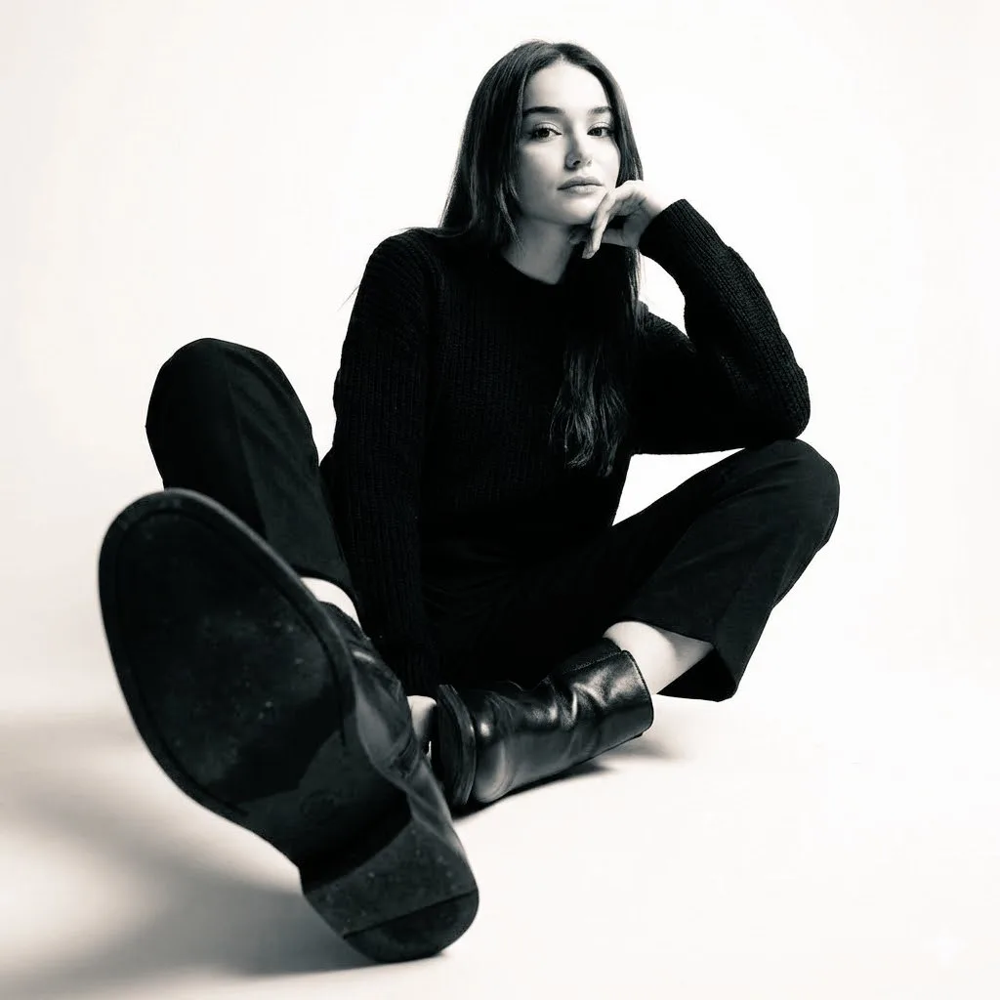

# simply — by @kingofdairyque

[← Back to Community Examples](../../EXAMPLES.md) · Category: Photography · Model: `Nano Banana`

<a href="https://x.com/kingofdairyque/status/2011340606975721923"></a>

Source: **[@kingofdairyque on X](https://x.com/kingofdairyque/status/2011340606975721923)** · Creator: [simply](https://x.com/kingofdairyque)

## Prompt

```text
High-contrast black-and-white studio photo of a woman seated on the floor wearing a black sweater, black trousers, and black leather ankle boots. Legs are bent and open toward the camera, with one boot sole prominently facing the lens. Upper body slightly reclined, calm expression. Clean white background, dramatic low-angle composition. Don’t change the face. (Use the attached image)
```

## Try it

Paste the prompt into **[vinano.ai](https://vinano.ai?utm_source=github&utm_medium=readme&utm_campaign=awesome-image-video-prompts-updating&utm_content=x-page-try)** to generate your own version.

> The image and prompt belong to @kingofdairyque ([original post](https://x.com/kingofdairyque/status/2011340606975721923)) and are shown here with credit for reference. Creators can ask for changes or removal by opening an issue.
