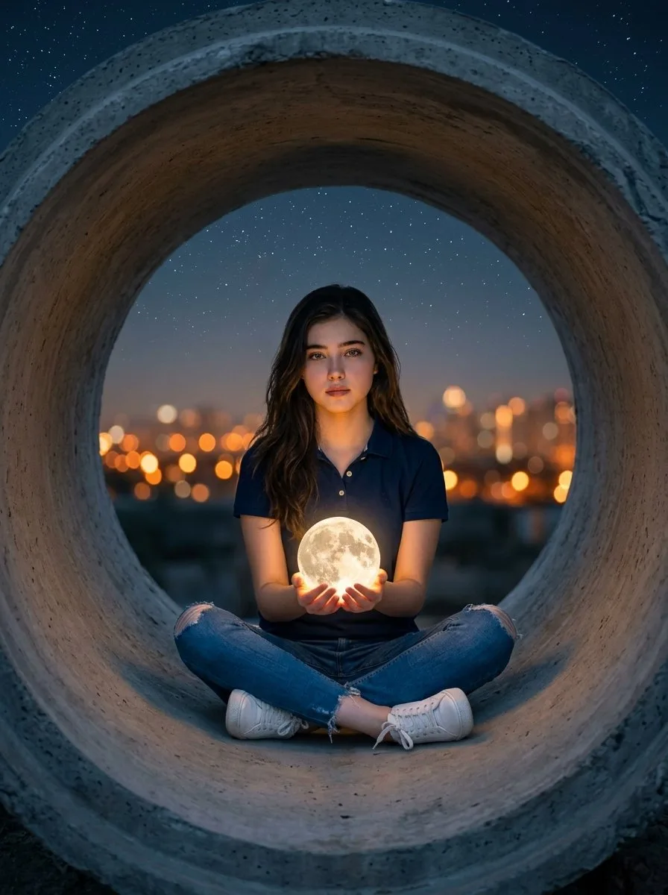

# Hania Ai — by @HaniaAi12

[← Back to Community Examples](../../EXAMPLES.md) · Category: Photography · Model: `Nano Banana`

<a href="https://x.com/HaniaAi12/status/2034800521538621542"></a>

Source: **[@HaniaAi12 on X](https://x.com/HaniaAi12/status/2034800521538621542)** · Creator: [Hania Ai](https://x.com/HaniaAi12)

## Prompt

```text
Hyper-realistic surreal photography of a woman sitting inside a massive, rough concrete pipe, featuring the uploaded face as reference. She wears a dark polo shirt, ripped jeans, and white sneakers, with a calm and thoughtful expression. She is gently holding a glowing, miniature full moon in her cupped hands. The surreal moon casts a warm, magical rim light across her face and body. The camera is positioned from inside the pipe, creating a natural circular frame around her. In the background, a starry night sky is visible along with a deeply blurred cityscape filled with warm orange bokeh lights. Shot with a 50mm lens, shallow depth of field, high contrast, blending cool night tones with the ethereal glow of the moon in her hands.
```

## Try it

Paste the prompt into **[vinano.ai](https://vinano.ai?utm_source=github&utm_medium=readme&utm_campaign=awesome-image-video-prompts-updating&utm_content=x-page-try)** to generate your own version.

> The image and prompt belong to @HaniaAi12 ([original post](https://x.com/HaniaAi12/status/2034800521538621542)) and are shown here with credit for reference. Creators can ask for changes or removal by opening an issue.
