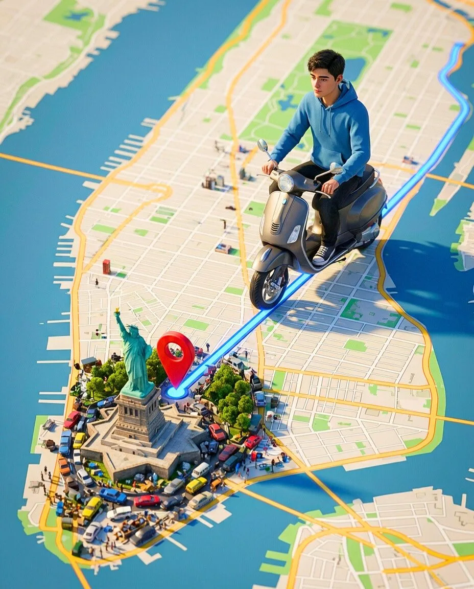

# TechieSA — by @TechieBySA

[← Back to Community Examples](../../EXAMPLES.md) · Category: Illustration & 3D · Model: `Nano Banana`

<a href="https://x.com/TechieBySA/status/2015436671286648863"></a>

Source: **[@TechieBySA on X](https://x.com/TechieBySA/status/2015436671286648863)** · Creator: [TechieSA](https://x.com/TechieBySA)

## Prompt

```text
Vertical 4:5 surreal 3D scene featuring a photorealistic character generated strictly from the attached reference image (accurate facial likeness, skin texture, age, proportions).

Front-facing view, camera slightly above eye level, the character riding his own scooter or motorbike directly on top of the blue GPS route line itself, moving forward toward a red destination pin.

The character wears culturally neutral, realistic urban clothing inspired by [COUNTRY], with accurate fabric behavior and natural riding posture.

Below, a stylized GPS-style city map of [CITY] fills the scene. A chaos zone at [LANDMARK / AREA] shows dense miniature cars, people, buildings, trees, and urban clutter concentrated near the destination.

Natural daylight, cinematic shadows, sharp focus on the character, and subtle depth of field on the map.

High-end concept-art quality combining photoreal human + stylized miniature city.
```

## Try it

Paste the prompt into **[vinano.ai](https://vinano.ai?utm_source=github&utm_medium=readme&utm_campaign=awesome-image-video-prompts-updating&utm_content=x-page-try)** to generate your own version.

> The image and prompt belong to @TechieBySA ([original post](https://x.com/TechieBySA/status/2015436671286648863)) and are shown here with credit for reference. Creators can ask for changes or removal by opening an issue.
