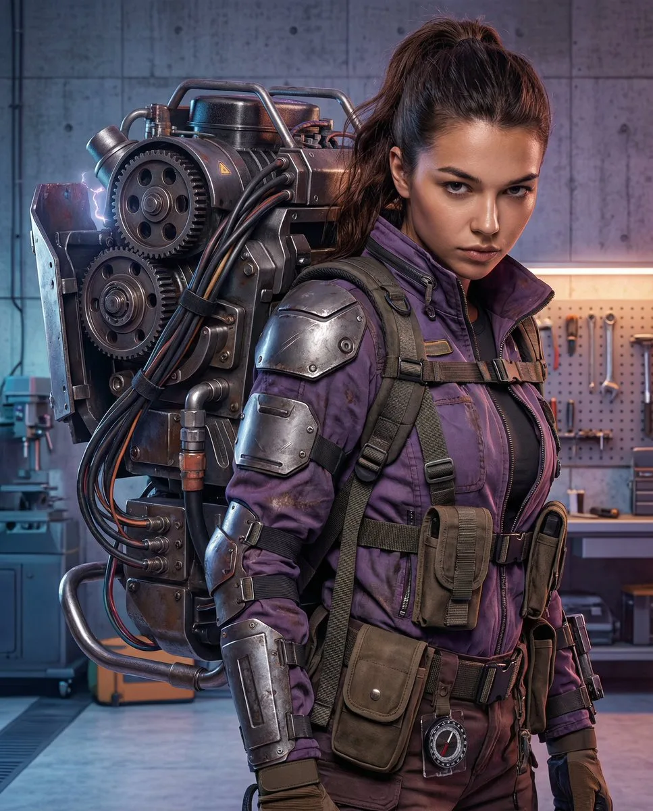

# 𝗦𝗮𝗻𝗶𝗮 — by @saniaspeaks_

[← Back to Examples from X](../../EXAMPLES.md) · Category: Illustration & 3D · Model: `Nano Banana`

<a href="https://x.com/saniaspeaks_/status/2026812324082782705"></a>

Original post: **[@saniaspeaks_ on X](https://x.com/saniaspeaks_/status/2026812324082782705)** · Creator: [𝗦𝗮𝗻𝗶𝗮](https://x.com/saniaspeaks_)

## Prompt

```text
{
  "type": "image_generation_prompt",
  "style": "ultra-realistic, cinematic, sci-fi mech aesthetic, cyberpunk",
  "resolution": "8K",
  "aspect_ratio": "2:3",
  "scene": {
    "location": "industrial workshop",
    "background": "clean minimal workshop environment with subtle machinery elements and soft atmospheric haze"
  },
  "subject": {
    "gender": "female",
    "role": "cyberpunk mechanic",
    "identity": {
      "same_face": true,
      "same_character": true,
      "preserve_facial_features": true,
      "realism": "exact facial structure, skin texture, and expression retained"
    },
    "pose": {
      "stance": "standing strong and confident",
      "body_language": "powerful, grounded posture"
    },
    "appearance": {
      "outfit": {
        "jacket": "purple futuristic techwear jacket",
        "details": [
          "tactical straps",
          "utility pouches",
          "reinforced armored panels",
          "futuristic cyberpunk textures"
        ]
      }
    },
    "equipment": {
      "exosuit_backpack": {
        "type": "massive mechanical industrial exosuit",
        "components": [
          "large industrial engine core",
          "exposed wires and cables",
          "metal pipes and hydraulic tubes",
          "heavy mechanical armor plates",
          "mechanical joints and connectors"
        ],
        "style": "futuristic sci-fi mech design, functional and industrial"
      }
    }
  },
  "lighting": {
    "type": "cinematic industrial lighting",
    "details": [
      "soft dramatic shadows",
      "cool and warm mixed highlights",
      "subtle volumetric light",
      "metal reflections and glow accents"
    ]
  },
  "camera": {
    "focus": "sharp focus on subject and exosuit",
    "depth_of_field": "shallow with soft background separation",
    "composition": "centered, full-body or mid-body portrait"
  },
  "quality": {
    "detail_level": "hyper detailed",
    "textures": "ultra realistic skin, fabric, and metal textures",
    "sharpness": "extremely sharp",
    "noise": "clean high-resolution render"
  },
  "mood": "powerful, futuristic, cinematic, sci-fi industrial",
  "constraints": [
    "no cartoon style",
    "no low detail",
    "no distortion",
    "no watermark",
    "no text overlay",
    "no unrealistic anatomy"
  ],
  "output_goal": "Create a hyper-realistic cinematic portrait of a cyberpunk mechanic girl wearing a massive mechanical exosuit backpack with industrial engine components, wires, pipes, and metal armor, standing strong in a minimal workshop environment with dramatic lighting and ultra-detailed sci-fi mech aesthetics."
}
```

## Try it

Paste the prompt into **[vinano.ai](https://vinano.ai?utm_source=github&utm_medium=readme&utm_campaign=awesome-image-video-prompts-updating&utm_content=x-page-try)** to generate your own version.

> The image and prompt belong to [@saniaspeaks_](https://x.com/saniaspeaks_) and are shown here with credit for reference. Creators can ask for changes or removal by opening an issue.
