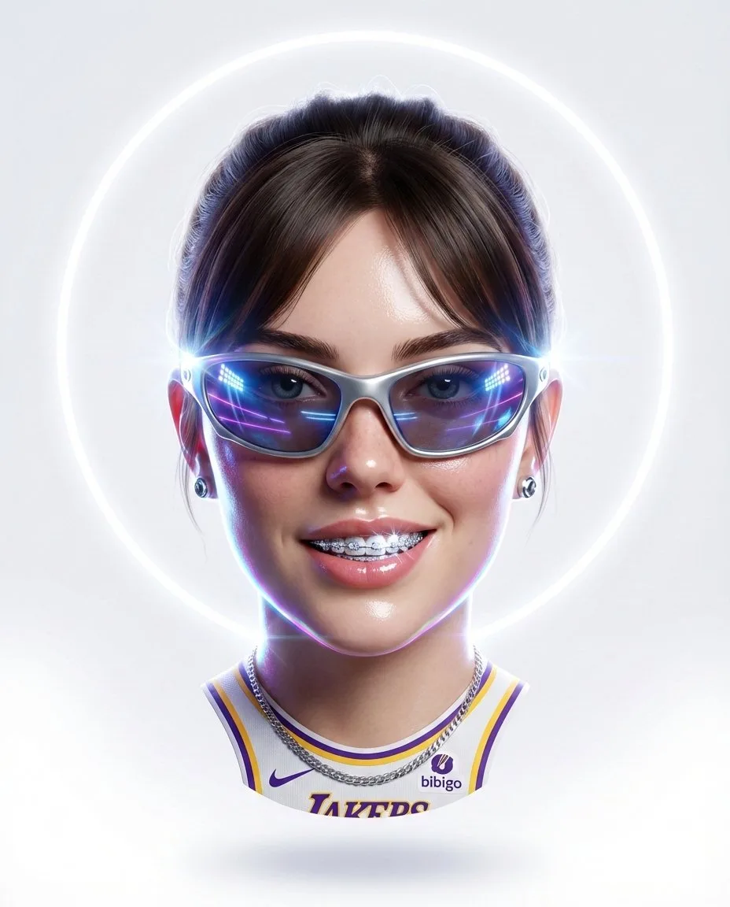

# simeon-sanai — by @Naiknelofar788

[← Back to Examples from X](../../EXAMPLES.md) · Category: Illustration & 3D · Model: `Nano Banana`

<a href="https://x.com/Naiknelofar788/status/2026207647968743551"></a>

Original post: **[@Naiknelofar788 on X](https://x.com/Naiknelofar788/status/2026207647968743551)** · Creator: [simeon-sanai](https://x.com/Naiknelofar788)

## Prompt

```text
Hyper-stylized dynamic 3D floating head portrait of the attached reference image, perfectly centered, upright, symmetrical, filling 80% of the 4:5 frame. No neck. No shoulder edges. Clean cut-out. Subject floating in white space.Predominantly white background enhanced with subtle tonal gradients and soft volumetric glow. A thin luminous neon halo ring glows behind the head, slightly diffused but clean and circular.

Facial features match reference photo precisely. Expression: confident, dominant smirk with focused eye contact. Diamond-studded braces sparkle under sharp lighting.

Sleek silver sports sunglasses reflect digital stadium lights and neon streaks. Chrome stud earrings and polished silver chain subtly visible.

Official lakers shirt strictly front view chest logo and sponsor visible only.

Lighting combines bright frontal fill with strong rim lights. Subtle neon reflections trace along jawline edges. Micro lens flares appear at high-intensity highlights.

White-on-white energy with controlled neon accents. Futuristic champion aura. Glossy skin, exaggerated reflections, cinematic intensity.

Aspect ratio 4:5.
```

## Try it

Paste the prompt into **[vinano.ai](https://vinano.ai?utm_source=github&utm_medium=readme&utm_campaign=awesome-image-video-prompts-updating&utm_content=x-page-try)** to generate your own version.

> The image and prompt belong to [@Naiknelofar788](https://x.com/Naiknelofar788) and are shown here with credit for reference. Creators can ask for changes or removal by opening an issue.
