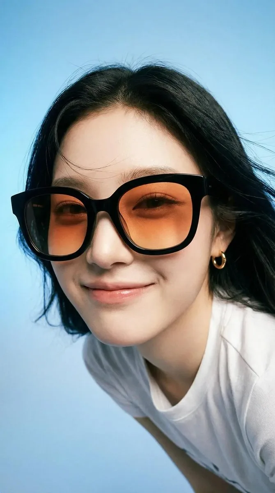

# Kashberg — by @Kashberg_0

[← Back to Community Examples](../../EXAMPLES.md) · Category: Photography · Model: `Nano Banana`

<a href="https://x.com/Kashberg_0/status/2045337223638515794"></a>

Source: **[@Kashberg_0 on X](https://x.com/Kashberg_0/status/2045337223638515794)** · Creator: [Kashberg](https://x.com/Kashberg_0)

## Prompt

```text
Photorealistic editorial portrait of a smiling woman using the exact same face from the reference image. She wears oversized black sunglasses with orange lenses and small gold earrings. Slightly leaning forward in a close wide-angle perspective, with a playful, mischievous expression and subtle smirk. Clean blue studio background with soft gradient. Bright soft lighting with gentle contrast, sharp focus, minimal high-fashion mood.
```

## Try it

Paste the prompt into **[vinano.ai](https://vinano.ai?utm_source=github&utm_medium=readme&utm_campaign=awesome-image-video-prompts-updating&utm_content=x-page-try)** to generate your own version.

> The image and prompt belong to @Kashberg_0 ([original post](https://x.com/Kashberg_0/status/2045337223638515794)) and are shown here with credit for reference. Creators can ask for changes or removal by opening an issue.
