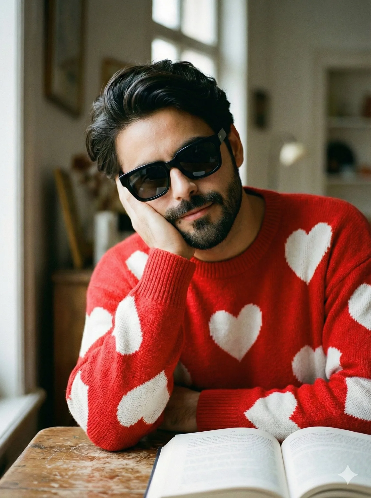

# Zar⭕on — by @Xaroonx

[← Back to Examples from X](../../EXAMPLES.md) · Category: Photography · Model: `Nano Banana`

<a href="https://x.com/Xaroonx/status/2008556843954827601"></a>

Original post: **[@Xaroonx on X](https://x.com/Xaroonx/status/2008556843954827601)** · Creator: [Zar⭕on](https://x.com/Xaroonx)

## Prompt

```text
Concept & Mood

Intimate lifestyle–fashion editorial with quiet masculine warmth and thoughtful calm.
Soft, cozy atmosphere reminiscent of a private winter afternoon spent reading indoors.
Emotional restraint with gentle confidence — reflective, composed, subtly romantic without performance.
Feels like a real, candid moment captured naturally, not posed or styled for effect.

---

Subject & Anatomy

Adult man with realistic proportions and natural build.
Relaxed posture with subtle asymmetry — body leaning forward slightly, one arm resting on the table, head supported by the hand.
Natural weight distribution through the elbow and forearm resting on the surface.
No tension in the shoulders or neck, posture feels unforced and comfortable.

---

Pose & Perspective

Seated at a wooden table indoors.
Head gently tilted, cheek resting against the palm of the hand.
Other arm relaxed and folded near an open book on the table.
Camera positioned at eye level, slightly off-center, creating an intimate, conversational perspective.
Framing is mid-close portrait, focusing on face, hands, and upper torso.

---

Face & Expression

Soft, calm expression with a subtle, knowing half-smile.
Eyes relaxed and warm, making gentle eye contact with the camera.
Brows natural and expressive, conveying ease and quiet confidence rather than performance.
Facial hair neatly groomed with realistic density and texture.

---

Skin (Key Focus)

Highly realistic skin texture featuring:

visible pores

natural tonal variation

subtle under-eye texture

realistic beard shadow and transitions
Skin appears alive and tactile.
No smoothing, no beauty retouching, no artificial glow or plastic finish.

---

Hair & Grooming

Medium-length dark hair with natural volume and movement.
Softly tousled with slight wave, imperfect strands falling naturally across the forehead.
Hair density realistic, not styled or over-defined.
Beard neatly trimmed, edges soft and organic, not sharply sculpted.

---

Wardrobe & Styling

Cozy red knit sweater with small white heart motifs.
Fabric appears thick and warm, with:

visible knit texture

realistic folds and stretch around elbows and shoulders

natural drape and compression at contact points
Sweater reads as casual, intimate, and personal — not fashion-staged.

---

Environment & Props

Simple indoor setting with a wooden table surface.
An open book placed naturally in front of the subject, pages slightly curved and imperfect.
Background softly blurred, suggesting a quiet home or café interior.
No distracting elements, environment supports calm and intimacy.

---

Lighting

Soft natural window light only.
Light falls gently across the face, creating smooth highlight-to-shadow transitions.
Warm, diffused illumination with no harsh shadows.
No artificial lighting, no flash, no studio feel.

---

Camera & Optics

Photographer mindset.
Full-frame look with a 50–55mm perspective.
Shallow depth of field — face and eyes in sharp focus, background softly blurred.
Natural optical falloff with subtle softness, not clinical sharpness.

---

Color & Film Feel

Warm, restrained color palette:

deep knit red

natural skin tones

warm wood browns

soft neutral background hues
Film-inspired tonality similar to Portra-style color science:
soft contrast, gentle highlights, realistic skin color retention.
No HDR, no heavy grading, no oversaturation.

---

Style & Realism

Cinematic realism with emotional subtlety.
Feels like a real lifestyle or fashion editorial captured on natural light.
Quiet, confident, intimate — grounded in reality.
No exaggeration, no fantasy elements.

---

Technical

Aspect ratio: 3:4
High resolution, ultra-photorealistic detail
Natural grain structure
Shallow depth of field
No text, no logos, no watermarks
```

## Try it

Paste the prompt into **[vinano.ai](https://vinano.ai?utm_source=github&utm_medium=readme&utm_campaign=awesome-image-video-prompts-updating&utm_content=x-page-try)** to generate your own version.

> The image and prompt belong to [@Xaroonx](https://x.com/Xaroonx) and are shown here with credit for reference. Creators can ask for changes or removal by opening an issue.
