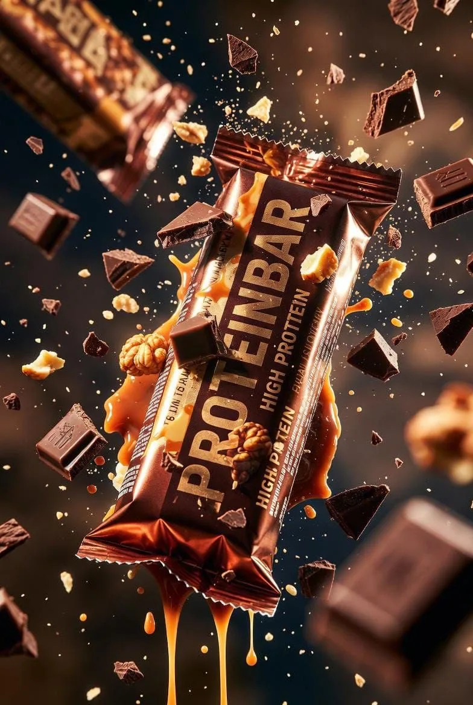

# Kashberg — by @Kashberg_0

[← Back to Community Examples](../../EXAMPLES.md) · Category: Food & Drink · Model: `Nano Banana`

<a href="https://x.com/Kashberg_0/status/2019985216308429143"></a>

Source: **[@Kashberg_0 on X](https://x.com/Kashberg_0/status/2019985216308429143)** · Creator: [Kashberg](https://x.com/Kashberg_0)

## Prompt

```text
Ultra-cinematic product photography of a premium protein bar wrapped in metallic packaging, floating at a dynamic angle; explosive chocolate chunks, caramel drips, and nut fragments frozen mid-air; high-speed splash and crumble effect, dramatic studio lighting with sharp highlights; rich brown and gold palette, ultra-detailed textures, shallow depth of field, photorealistic, 8K, fitness luxury advertising.
```

## Try it

Paste the prompt into **[vinano.ai](https://vinano.ai?utm_source=github&utm_medium=readme&utm_campaign=awesome-image-video-prompts-updating&utm_content=x-page-try)** to generate your own version.

> The image and prompt belong to @Kashberg_0 ([original post](https://x.com/Kashberg_0/status/2019985216308429143)) and are shown here with credit for reference. Creators can ask for changes or removal by opening an issue.
