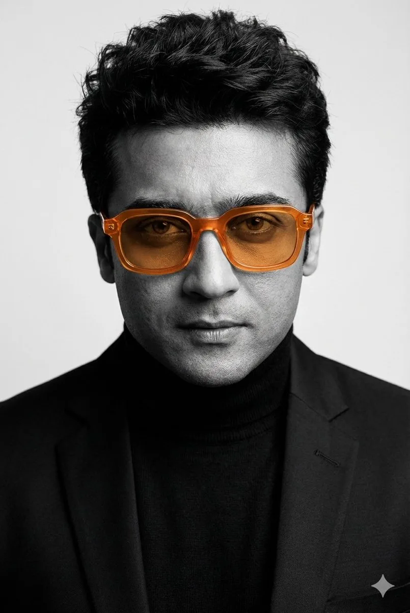

# Abhi — by @Abhiew_

[← Back to Examples from X](../../EXAMPLES.md) · Category: Photography · Model: `Nano Banana`

<a href="https://x.com/Abhiew_/status/2016414841779704227"></a>

Original post: **[@Abhiew_ on X](https://x.com/Abhiew_/status/2016414841779704227)** · Creator: [Abhi](https://x.com/Abhiew_)

## Prompt

```text
A close-up studio portrait of me, masculine features, textured messy hair neatly styled.
I wear a black tailored blazer with sharp structure and clean lines, layered over a black high-neck turtleneck, embodying a minimalist and contemporary fashion style.
The man is wearing bold translucent orange acetate sunglasses, rectangular frame with slightly rounded edges, glossy finish, amber/orange tinted lenses, and fashion-forward and statement eyewear. Color concept: selective color photography - monochrome black and white image with only the sunglasses in vibrant orange color, creating strong contrast and visual focus.
Expression: calm, confident, serious gaze, looking straight into the camera.
Lighting: soft studio lighting from the front with subtle side shadows, even skin tones, greath detai,l facial texture, and cinematic contrast. Camera settings:
- Lens: 85mm portrait lens
- Aperture: f/2.0
- ISO: 100
- Shutter speed: 1/125
- High resolution, ultra-sharp focus on face Style: editorial fashion portrait, luxury menswear, realistic skin texture, non-Al look, professional studio photography.
```

## Try it

Paste the prompt into **[vinano.ai](https://vinano.ai?utm_source=github&utm_medium=readme&utm_campaign=awesome-image-video-prompts-updating&utm_content=x-page-try)** to generate your own version.

> The image and prompt belong to [@Abhiew_](https://x.com/Abhiew_) and are shown here with credit for reference. Creators can ask for changes or removal by opening an issue.
