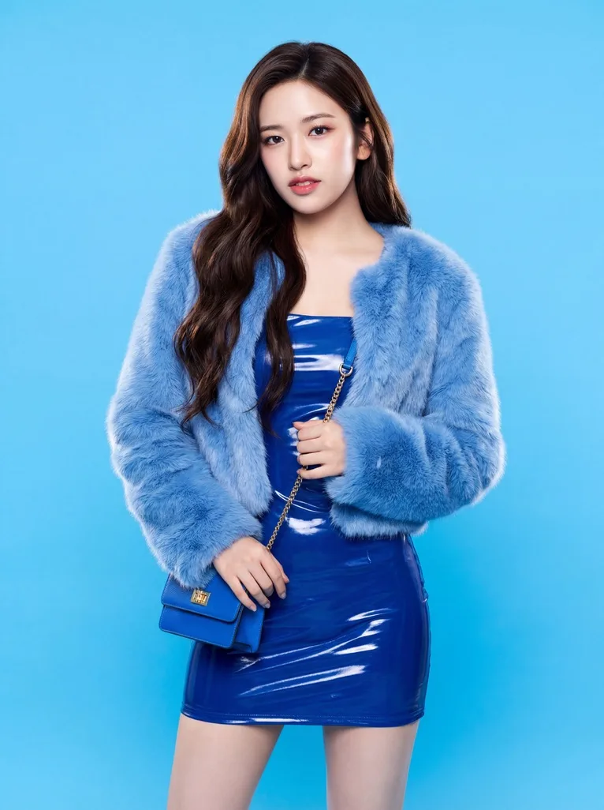

# Alice — by @youngcatwoman

[← Back to Community Examples](../../EXAMPLES.md) · Category: Photography · Model: `Nano Banana`

<a href="https://x.com/youngcatwoman/status/2032985380723527761"></a>

Source: **[@youngcatwoman on X](https://x.com/youngcatwoman/status/2032985380723527761)** · Creator: [Alice](https://x.com/youngcatwoman)

## Prompt

```text
{
"prompt": "ultra-detailed fashion portrait of a beautiful young Korean woman, exactly matching An Yujin from IVE, tall athletic elegant figure, standing confidently in a vibrant all-blue studio, wearing a tight glossy blue patent latex bodycon mini dress that hugs every curve, shiny reflective blue vinyl material, deep cobalt blue color, sleeveless square neckline, short length above mid-thigh, layered with a luxurious fluffy soft blue faux fur cropped jacket with fuzzy long fur texture, open front, long voluminous dark brown hair with perfect loose Hollywood waves cascading down to waist, charismatic deep eyes, full glossy nude-pink lips, dramatic makeup with long lashes, sharp eyeliner, flawless glowing fair skin, confident seductive expression, slight head tilt, holding a small structured hot blue designer crossbody purse with gold chain strap, bright even baby blue background, soft professional studio lighting, high fashion editorial style, hyper-realistic, ultra sharp details, 8k resolution, photorealistic skin texture, intricate fur details, reflective latex shine, azurecore aesthetic, maximalist blue glamour, shot on Canon EOS R5, 85mm lens, f/1.8, cinematic color grading",
"negative_prompt": "low quality, blurry, deformed, ugly, extra limbs, bad anatomy, poorly drawn face, bad proportions, watermark, text, logo, cropped, out of frame, skinny, thin body, small chest, flat figure, realistic clothing texture instead of latex, muted colors, dark background, green skin, male",
"parameters": {
"aspect_ratio": "9:16",
"style": "photorealistic fashion photography",
"lighting": "soft studio lighting with subtle rim light",
"quality_tags": "masterpiece, best quality, ultra detailed, highly detailed, sharp focus",
"sampler": "DPM++ 2M Karras or Euler a",
"steps": 35,
"cfg_scale": 7.5,
"seed": -1
},
"model_recommendations": [
"Flux.1 dev",
"Realistic Vision V6.0",
"Juggernaut XL",
"Photon",
"Midjourney v6"
]
}
```

## Try it

Paste the prompt into **[vinano.ai](https://vinano.ai?utm_source=github&utm_medium=readme&utm_campaign=awesome-image-video-prompts-updating&utm_content=x-page-try)** to generate your own version.

> The image and prompt belong to @youngcatwoman ([original post](https://x.com/youngcatwoman/status/2032985380723527761)) and are shown here with credit for reference. Creators can ask for changes or removal by opening an issue.
