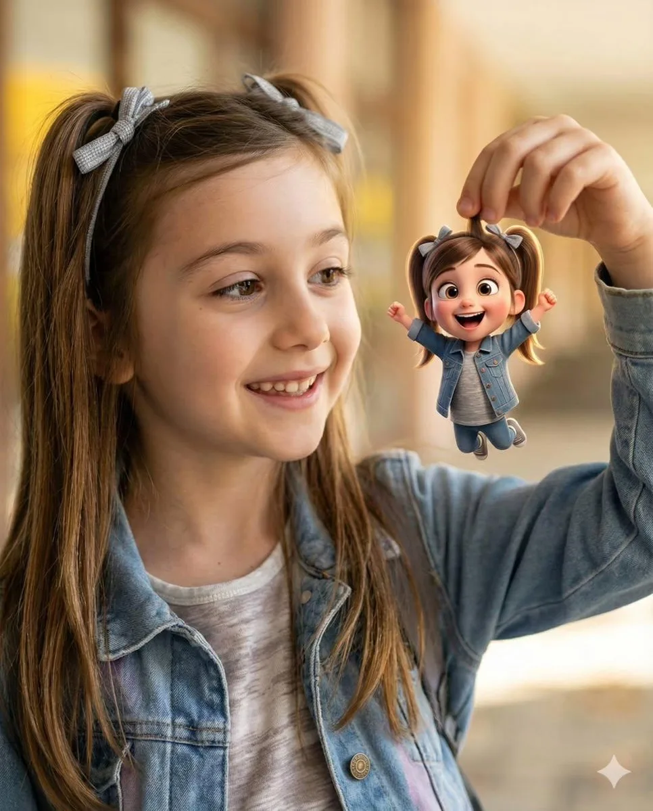

# Taaruk — by @Taaruk_

[← Back to Community Examples](../../EXAMPLES.md) · Category: Illustration & 3D · Model: `Nano Banana`

<a href="https://x.com/Taaruk_/status/2011282431744336078"></a>

Source: **[@Taaruk_ on X](https://x.com/Taaruk_/status/2011282431744336078)** · Creator: [Taaruk](https://x.com/Taaruk_)

## Prompt

```text
{
  "Objective": "Create a heartwarming, whimsical portrait blending photorealistic realism with a tiny Pixar-style animated character",
  "PersonaDetails": {
    "PrimarySubject": {
      "Type": "Young girl",
      "Expression": "Bright, joyful smile",
      "Hair": {
        "Style": "Long light-brown hair",
        "Accessories": "Cute ribbon bows"
      },
      "Wardrobe": {
        "Outerwear": "Casual denim jacket",
        "Top": "Soft neutral-colored shirt"
      }
    },
    "SecondarySubject": {
      "Type": "Tiny 3D cartoon version of the girl",
      "Scale": "Miniature, held delicately between fingers",
      "Style": "Pixar-style 3D character",
      "Proportions": "Oversized expressive eyes, rounded features",
      "Hair": "Pigtails matching the real girl",
      "Wardrobe": "Denim outfit matching the real subject",
      "Pose": "Arms raised joyfully"
    }
  },
  "Composition": {
    "Framing": "Close-up to medium portrait",
    "Interaction": "Clear playful interaction between girl and miniature character",
    "DepthOfField": "Shallow depth of field",
    "Focus": "Ultra-sharp focus on both faces"
  },
  "LightingAndBackground": {
    "Lighting": "Warm natural daylight",
    "Background": {
      "Style": "Soft golden bokeh",
      "Mood": "Dreamy, magical"
    }
  },
  "ArtDirection": {
    "StyleFusion": [
      "Photorealistic child portrait photography",
      "Pixar-style 3D animated character"
    ],
    "Aesthetic": "Magical realism with playful scale contrast",
    "TextureDetail": "Ultra-detailed skin, fabric, and 3D materials"
  },
  "MoodAndTone": {
    "Mood": "Heartwarming, joyful, whimsical",
    "EmotionalFeel": "Wonder, innocence, playful imagination"
  },
  "PhotographyStyle": {
    "Genre": "Cinematic lifestyle portrait photography",
    "LensFeel": "Portrait lens with creamy bokeh",
    "ImageQuality": "8K ultra-high realism"
  },
  "NegativePrompt": [
    "uncanny valley",
    "scary doll",
    "low-quality 3D",
    "harsh lighting",
    "oversaturated colors",
    "blurry focus",
    "flat expression"
  ],
  "ResponseFormat": {
    "Type": "Single image",
    "Orientation": "Portrait",
    "AspectRatio": "2:3"
  }
}
```

## Try it

Paste the prompt into **[vinano.ai](https://vinano.ai?utm_source=github&utm_medium=readme&utm_campaign=awesome-image-video-prompts-updating&utm_content=x-page-try)** to generate your own version.

> The image and prompt belong to @Taaruk_ ([original post](https://x.com/Taaruk_/status/2011282431744336078)) and are shown here with credit for reference. Creators can ask for changes or removal by opening an issue.
