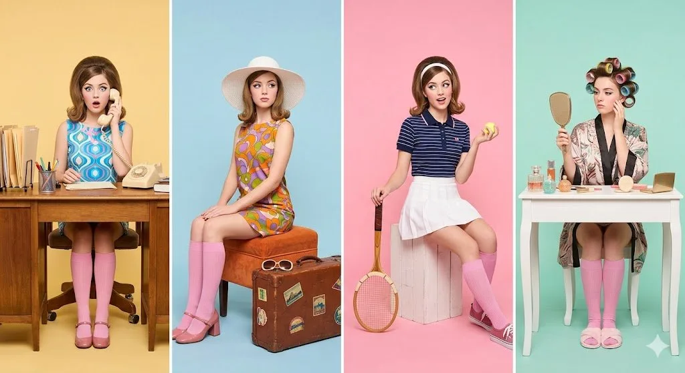

# Cherry 2.O — by @Mind_Boticni

[← Back to Community Examples](../../EXAMPLES.md) · Category: Poster Design · Model: `Nano Banana`

<a href="https://x.com/Mind_Boticni/status/2043539455131459957"></a>

Source: **[@Mind_Boticni on X](https://x.com/Mind_Boticni/status/2043539455131459957)** · Creator: [Cherry 2.O](https://x.com/Mind_Boticni)

## Prompt

```text
A retro-inspired studio photoshoot featuring a young woman styled in four different personas, arranged in a horizontal split-panel composition. Each panel has a bold pastel background in contrasting colors (yellow, blue, pink, mint). The same woman appears in each panel wearing vintage 1960s fashion with bright patterns, pink knee-high socks, and expressive makeup.
Panel 1 (Office theme): She sits behind a desk with office props like folders, a rotary phone, and stationery, wearing a patterned dress and looking surprised while holding the phone.
Panel 2 (Travel theme): She wears a wide-brim hat and colorful outfit, sitting with a vintage suitcase and travel accessories, posing elegantly.
Panel 3 (Sports theme): She wears a sporty retro outfit, holding a tennis racket and ball, sitting casually with playful energy.
Panel 4 (Home theme): She wears a robe with hair rollers, holding a hand mirror, sitting at a vanity table with beauty items.
Each panel is cleanly divided, perfectly symmetrical, with consistent lighting and camera angle. Bright, soft studio lighting, high fashion editorial style, ultra-sharp, vibrant colors, minimal shadows, no text, no logos, no labels, no watermarks.
Style: vintage pop art, Wes Anderson symmetry, fashion editorial photography, pastel color blocking, high resolution, 8k, clean composition.
```

## Try it

Paste the prompt into **[vinano.ai](https://vinano.ai?utm_source=github&utm_medium=readme&utm_campaign=awesome-image-video-prompts-updating&utm_content=x-page-try)** to generate your own version.

> The image and prompt belong to @Mind_Boticni ([original post](https://x.com/Mind_Boticni/status/2043539455131459957)) and are shown here with credit for reference. Creators can ask for changes or removal by opening an issue.
