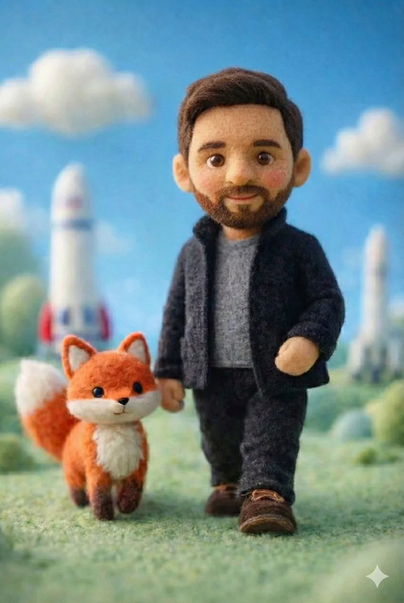

# Johnn — by @john_my07

[← Back to Community Examples](../../EXAMPLES.md) · Category: Illustration & 3D · Model: `Nano Banana`

<a href="https://x.com/john_my07/status/2012051946979667992"></a>

Source: **[@john_my07 on X](https://x.com/john_my07/status/2012051946979667992)** · Creator: [Johnn](https://x.com/john_my07)

## Prompt

```text
A handcrafted felt miniature scene featuring a soft wool doll character with simplified facial features, round button eyes, rosy cheeks, and a gentle smile. The character wears a dark felt jacket, gray wool t-shirt, and matching trousers, styled in a minimal casual tech look. He is walking on grassy felt terrain alongside a small felt fox companion. Whimsical storybook environment with pastel greenery, soft clouds, and a bright blue sky, subtle miniature rockets blurred in the background. Macro photography style, shallow depth of field, soft natural daylight, stop-motion animation aesthetic, ultra-detailed felt fibers and fabric textures, cozy cinematic mood, high quality.
```

## Try it

Paste the prompt into **[vinano.ai](https://vinano.ai?utm_source=github&utm_medium=readme&utm_campaign=awesome-image-video-prompts-updating&utm_content=x-page-try)** to generate your own version.

> The image and prompt belong to @john_my07 ([original post](https://x.com/john_my07/status/2012051946979667992)) and are shown here with credit for reference. Creators can ask for changes or removal by opening an issue.
