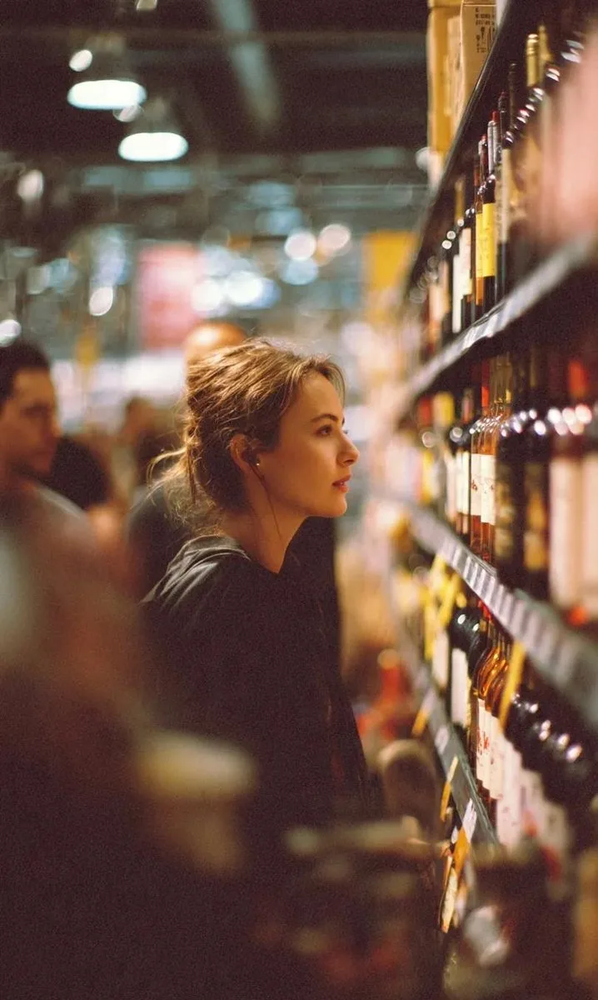

# Taaruk — by @Taaruk_

[← Back to Community Examples](../../EXAMPLES.md) · Category: Photography · Model: `Nano Banana`

<a href="https://x.com/Taaruk_/status/2045388206699667792"></a>

Source: **[@Taaruk_ on X](https://x.com/Taaruk_/status/2045388206699667792)** · Creator: [Taaruk](https://x.com/Taaruk_)

## Prompt

```text
A cinematic side-profile portrait of a young woman standing in a grocery store aisle, carefully looking at a shelf filled with wine bottles. She has her hair tied in a loose messy bun and wears a simple dark outfit. The environment is softly lit with warm indoor lighting, creating a cozy, realistic atmosphere. The shelves are filled with neatly arranged bottles, while other shoppers appear blurred in the background. Shallow depth of field with strong foreground and background blur, creamy bokeh lights, natural skin tones, documentary-style photography, candid moment, 50mm lens, f/1.8, ultra-realistic detail, cinematic color grading, 8K.
```

## Try it

Paste the prompt into **[vinano.ai](https://vinano.ai?utm_source=github&utm_medium=readme&utm_campaign=awesome-image-video-prompts-updating&utm_content=x-page-try)** to generate your own version.

> The image and prompt belong to @Taaruk_ ([original post](https://x.com/Taaruk_/status/2045388206699667792)) and are shown here with credit for reference. Creators can ask for changes or removal by opening an issue.
