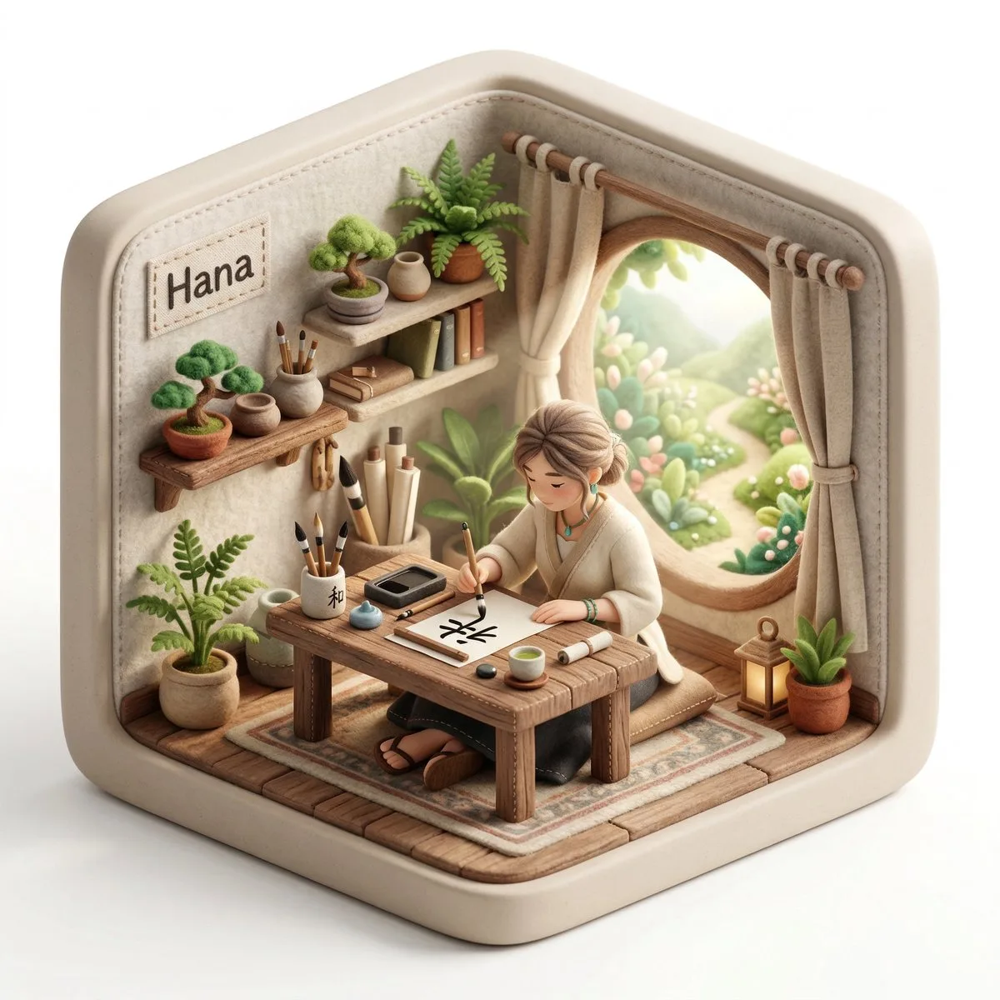

# Marcio Lima 利真 マルシオ 💎 — by @Preda2005

[← Back to Community Examples](../../EXAMPLES.md) · Category: Illustration & 3D · Model: `Nano Banana`

<a href="https://x.com/Preda2005/status/2035592959685525590"></a>

Source: **[@Preda2005 on X](https://x.com/Preda2005/status/2035592959685525590)** · Creator: [Marcio Lima 利真 マルシオ 💎](https://x.com/Preda2005)

## Prompt

```text
Create a 3D isometric diorama illustration of an original character named [CHARACTER NAME], peacefully working or practicing a creative activity in a nature-inspired environment, sitting at a wooden desk near a large open window with sunlight flowing in and soft greenery visible outside.

The character should be inspired by [ARCHETYPE / PROFESSION – e.g. writer, painter, meditator, calligraphy artist, tea master] and have a unique visual identity, including soft, natural clothing, organic textures, and a calm, introspective personality.

The entire scene must have a handcrafted felt aesthetic, with soft rounded shapes, visible stitching details, and clean, polished textures.

The diorama is enclosed inside a rounded cube structure with subtle hexagonal proportions, made of [MATERIAL STYLE – e.g. soft matte ceramic, light frosted resin, natural wood finish].

The environment must strongly reflect a peaceful, nature-connected lifestyle, including plants, natural wood furniture, soft textiles, and minimalistic decor.

On the desk, include small detailed objects such as [OBJECT 1 – e.g. tea cup], [OBJECT 2 – e.g. brush or pen], [OBJECT 3 – e.g. notebook or scroll].

Lighting should be bright, soft, and natural, with warm sunlight beams entering through the window, creating a serene and airy atmosphere, with a clean white background outside the diorama.

Render in 1080x1080, ultra-detailed, photorealistic style.

Include a small stitched fabric name tag sewn onto the INNER wall of the diorama (top-left corner inside the cube), clearly integrated into the scene, not floating and not outside the structure, displaying the name: [CHARACTER NAME].
```

## Try it

Paste the prompt into **[vinano.ai](https://vinano.ai?utm_source=github&utm_medium=readme&utm_campaign=awesome-image-video-prompts-updating&utm_content=x-page-try)** to generate your own version.

> The image and prompt belong to @Preda2005 ([original post](https://x.com/Preda2005/status/2035592959685525590)) and are shown here with credit for reference. Creators can ask for changes or removal by opening an issue.
