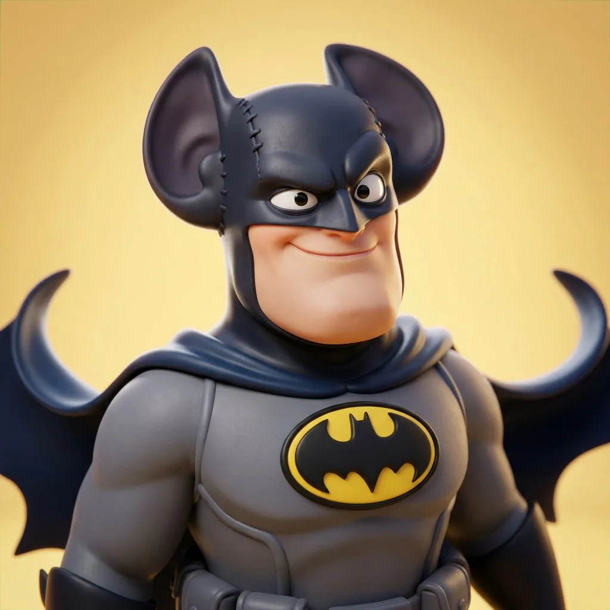

# Kaan — by @kaanakz

[← Back to Community Examples](../../EXAMPLES.md) · Category: Illustration & 3D · Model: `Nano Banana`

<a href="https://x.com/kaanakz/status/2033569344890802668"></a>

Source: **[@kaanakz on X](https://x.com/kaanakz/status/2033569344890802668)** · Creator: [Kaan](https://x.com/kaanakz)

## Prompt

```text
High-quality stylized 3D CGI big-head cartoon render of Harry Potter, square profile picture composition, oversized head and small shoulders in a playful Pixar-style caricature. Head and facial features exaggerated while keeping him instantly recognizable: messy dark hair, round glasses, lightning-shaped scar on the forehead, curious and brave expression. Portrait framing focused on the large head with a small portion of the shoulders visible, wearing Hogwarts robe collar and tie. Smooth polished materials, glossy animated film shading with refined Pixar-style character rendering. Soft cinematic lighting creating gentle highlights on the glasses. Minimalist bright magical red background inspired by Hogwarts colors, clean composition optimized for social media profile pictures, ultra-detailed, no text, no watermark.
```

## Try it

Paste the prompt into **[vinano.ai](https://vinano.ai?utm_source=github&utm_medium=readme&utm_campaign=awesome-image-video-prompts-updating&utm_content=x-page-try)** to generate your own version.

> The image and prompt belong to @kaanakz ([original post](https://x.com/kaanakz/status/2033569344890802668)) and are shown here with credit for reference. Creators can ask for changes or removal by opening an issue.
