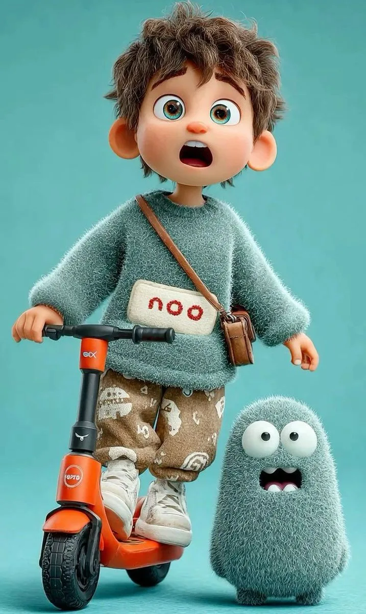

# auqib — by @auqibhabib

[← Back to Community Examples](../../EXAMPLES.md) · Category: Illustration & 3D · Model: `Nano Banana`

<a href="https://x.com/auqibhabib/status/2042541082580521244"></a>

Source: **[@auqibhabib on X](https://x.com/auqibhabib/status/2042541082580521244)** · Creator: [auqib](https://x.com/auqibhabib)

## Prompt

```text
3D Pixar-style animated child character, cute young boy with messy brown hair and big expressive blue eyes, surprised open-mouth expression, soft round face, wearing a fuzzy teal sweater with small “noo” text on chest, loose beige patterned pants, white sneakers, small brown crossbody bag, standing on an orange electric scooter, minimal teal studio background, soft lighting, ultra-detailed textures (fabric fuzz, skin, hair), cinematic depth of field, vibrant colors, highly polished render, octane render, 4k
```

## Try it

Paste the prompt into **[vinano.ai](https://vinano.ai?utm_source=github&utm_medium=readme&utm_campaign=awesome-image-video-prompts-updating&utm_content=x-page-try)** to generate your own version.

> The image and prompt belong to @auqibhabib ([original post](https://x.com/auqibhabib/status/2042541082580521244)) and are shown here with credit for reference. Creators can ask for changes or removal by opening an issue.
