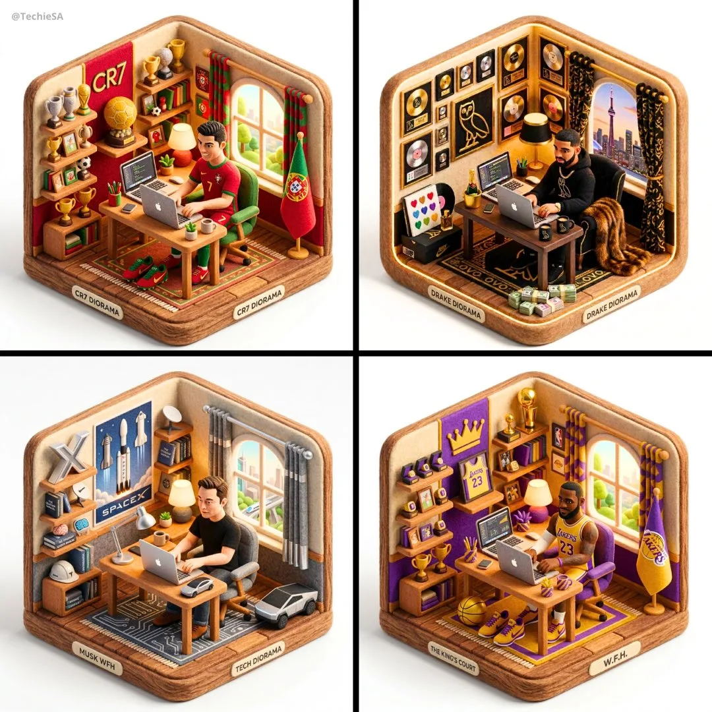

# TechieSA — by @TechieBySA

[← Back to Examples from X](../../EXAMPLES.md) · Category: Illustration & 3D · Model: `Nano Banana`

<a href="https://x.com/TechieBySA/status/2032155937532772551"></a>

Original post: **[@TechieBySA on X](https://x.com/TechieBySA/status/2032155937532772551)** · Creator: [TechieSA](https://x.com/TechieBySA)

## Prompt

```text
Generate a 3D isometric diorama illustration of [CHARACTER] working from home at a desk with a laptop and a window. Handmade felt appearance with rounded polished shapes, enclosed in a hexagonal rounded cube frame. The room decor, colours, furniture, wall art, and accessories are all instantly recognisable to [CHARACTER] — reflecting their signature style, iconic items, outfit, and personality. Warm soft lighting, clean white background, 1080x1080, photorealistic quality. No text labels or signs on the base.
```

## Try it

Paste the prompt into **[vinano.ai](https://vinano.ai?utm_source=github&utm_medium=readme&utm_campaign=awesome-image-video-prompts-updating&utm_content=x-page-try)** to generate your own version.

> The image and prompt belong to [@TechieBySA](https://x.com/TechieBySA) and are shown here with credit for reference. Creators can ask for changes or removal by opening an issue.
