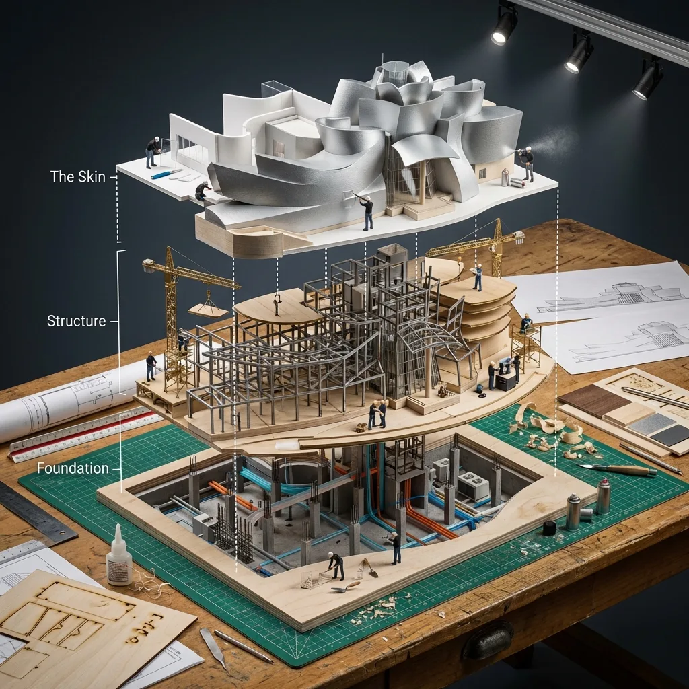

# Gadgetify — by @Gdgtify

[← Back to Examples from X](../../EXAMPLES.md) · Category: Illustration & 3D · Model: `Nano Banana`

<a href="https://x.com/Gdgtify/status/2018906863266345105"></a>

Original post: **[@Gdgtify on X](https://x.com/Gdgtify/status/2018906863266345105)** · Creator: [Gadgetify](https://x.com/Gdgtify)

## Prompt

```text
Input Variable: [Any Famous Building - Guggenheim, Burj Khalifa, Sydney Opera House, etc.]
System Instruction:
Generate a hyper-realistic, isometric 3D "Exploded View" diorama showing the Input Building deconstructed into its structural systems with an architectural model-making crew assembling a scale version.
1. Semantic Engineering Analysis:

Layer 1 (The Skin): Exterior facade panels, windows, cladding, roofing, entrance canopy
Layer 2 (The Structure): Steel framework, floor plates, columns, beams, elevator shafts, stairwells, mechanical systems
Layer 3 (The Foundation): Basement levels, support pillars, utility conduits, HVAC units, individual rivets/bolts, rebar cages

2.   Container:

Surface: Architect's drafting table with cutting mats and T-squares
Layout: Building layers stacked vertically showing ground-up construction sequence
Connections: White architectural section lines showing structural load paths and circulation
Additional Elements: Blueprint sheets, scale rulers, material samples, elevation drawings

3.  Micro-Narrative:

CRITICAL: This is meta - tiny workers building a model that's being built by tiny workers. Recursive scale concept.
Workers: 1:87 scale model makers in black turtlenecks (architect stereotype)
Equipment: Laser cutters, 3D printers, basswood cutting stations, acrylic gluing rigs, miniature cranes positioning floor plates
Interaction: Architects cutting foam core, assembling balsa wood frames, installing tiny windows, spray painting facades, arranging scale furniture

4. Visual Syntax & Material Physics:

Materials: Basswood grain, clear acrylic sheets, white foam core, brass rod framework, museum board textures
Lighting: Architecture studio track lighting creating dramatic model shadows
Special Effects: Glue strands, wood shavings, spray paint mist, laser cutter burn marks
Output: Elevated three-quarter view, architectural presentation, 1:1 ratio, 8K, Archdaily model photography aesthetic
```

## Try it

Paste the prompt into **[vinano.ai](https://vinano.ai?utm_source=github&utm_medium=readme&utm_campaign=awesome-image-video-prompts-updating&utm_content=x-page-try)** to generate your own version.

> The image and prompt belong to [@Gdgtify](https://x.com/Gdgtify) and are shown here with credit for reference. Creators can ask for changes or removal by opening an issue.
