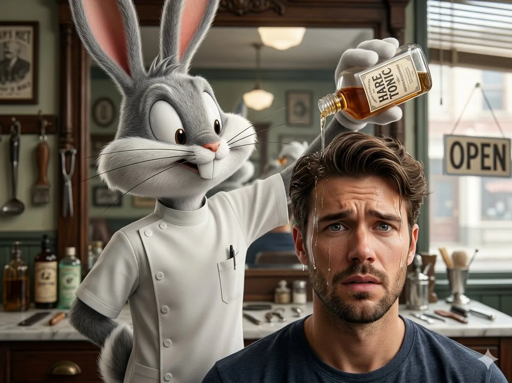

# Karlos — by @de_mon010

[← Back to Examples from X](../../EXAMPLES.md) · Category: Illustration & 3D · Model: `Nano Banana`

<a href="https://x.com/de_mon010/status/2038263197925253176"></a>

Original post: **[@de_mon010 on X](https://x.com/de_mon010/status/2038263197925253176)** · Creator: [Karlos](https://x.com/de_mon010)

## Prompt

```text
Cinematic 8k hyper-realistic close-up shot. A 3D realistic Bugs Bunny, faithful to his classic design but with detailed fur texture, wearing a white barber uniform. He is holding a bottle labeled "HARE TONIC" and pouring liquid onto the head of a sitting man. Man [photos reference with hair] has a worried and nervous expression, water dripping down his face. Vintage barbershop background with a mirror. Dynamic lighting, high detail, photorealistic rendering style
```

## Try it

Paste the prompt into **[vinano.ai](https://vinano.ai?utm_source=github&utm_medium=readme&utm_campaign=awesome-image-video-prompts-updating&utm_content=x-page-try)** to generate your own version.

> The image and prompt belong to [@de_mon010](https://x.com/de_mon010) and are shown here with credit for reference. Creators can ask for changes or removal by opening an issue.
