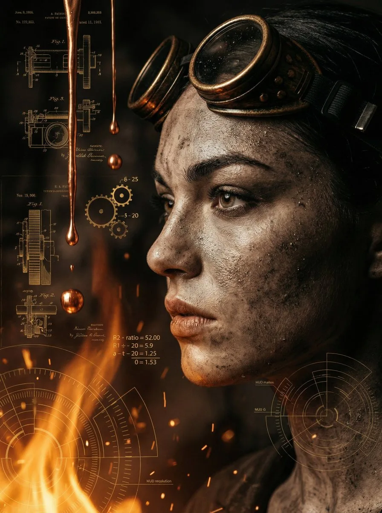

# Aijaz — by @iamsofiaijaz

[← Back to Community Examples](../../EXAMPLES.md) · Category: Photography · Model: `Nano Banana`

<a href="https://x.com/iamsofiaijaz/status/2023215251924389964"></a>

Source: **[@iamsofiaijaz on X](https://x.com/iamsofiaijaz/status/2023215251924389964)** · Creator: [Aijaz](https://x.com/iamsofiaijaz)

## Prompt

```text
A cinematic close-up profile of a weathered women with a salt-and-pepper face, wearing brass-rimmed aviator goggles pushed up. Low-key lighting with a heavy amber glow; thick molten copper droplets and incandescent heat waves shimmering in the air. Dark, soot-stained background layered with vintage patent blueprints, floating golden gear-ratio calculations, and radial HUD overlays. High contrast, grit-textured skin, hyper-realistic sweat beads, heavy industrial atmosphere, cinematic sepia grading, 8K, epic digital concept art..
```

## Try it

Paste the prompt into **[vinano.ai](https://vinano.ai?utm_source=github&utm_medium=readme&utm_campaign=awesome-image-video-prompts-updating&utm_content=x-page-try)** to generate your own version.

> The image and prompt belong to @iamsofiaijaz ([original post](https://x.com/iamsofiaijaz/status/2023215251924389964)) and are shown here with credit for reference. Creators can ask for changes or removal by opening an issue.
