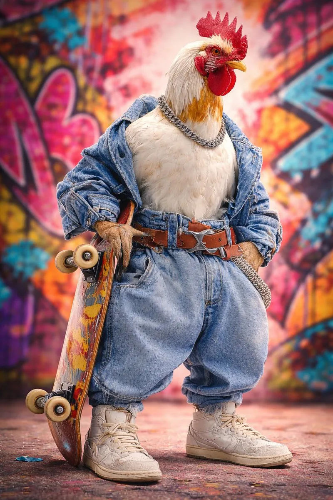

# Cherry 2.O — by @Mind_Boticni

[← Back to Community Examples](../../EXAMPLES.md) · Category: Illustration & 3D · Model: `Nano Banana`

<a href="https://x.com/Mind_Boticni/status/2016350733839597878"></a>

Source: **[@Mind_Boticni on X](https://x.com/Mind_Boticni/status/2016350733839597878)** · Creator: [Cherry 2.O](https://x.com/Mind_Boticni)

## Prompt

```text
Ultra-realistic studio portrait of an anthropomorphic rooster styled like a street skater. A confident white rooster with a red comb and wattles stands upright like a human, full body visible, facing slightly to the side. The rooster is wearing oversized vintage blue denim jeans with a loose, baggy fit, a faded denim jacket hanging off the shoulders, and a thick silver chain necklace around its neck. A brown leather belt is fastened tightly around the waist.
The rooster is holding a worn skateboard vertically with one wing, resting it on the floor. The skateboard has scratched trucks, beige wheels, and a distressed, colorful deck. On its feet are chunky white high-top sneakers with visible wear and realistic fabric texture.
Highly detailed feathers with realistic texture and volume, sharp focus on the rooster’s face and clothing. Studio lighting with soft shadows, clean white/neutral background, fashion editorial style. Cinematic realism, humorous yet stylish vibe, perfect balance between realism and surreal character design. Ultra-high resolution, hyper-detailed materials (denim fabric, leather belt, metal chain, feathers), shallow depth of field, professional photography look.
```

## Try it

Paste the prompt into **[vinano.ai](https://vinano.ai?utm_source=github&utm_medium=readme&utm_campaign=awesome-image-video-prompts-updating&utm_content=x-page-try)** to generate your own version.

> The image and prompt belong to @Mind_Boticni ([original post](https://x.com/Mind_Boticni/status/2016350733839597878)) and are shown here with credit for reference. Creators can ask for changes or removal by opening an issue.
