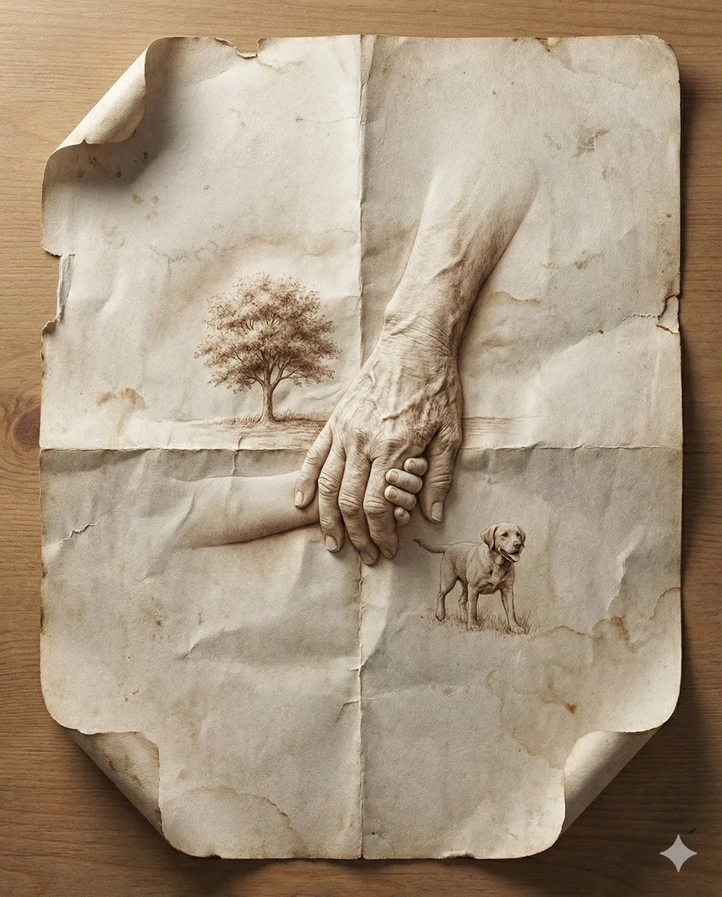

# Milo — by @Milo_Bahi_02

[← Back to Examples from X](../../EXAMPLES.md) · Category: Illustration & 3D · Model: `Nano Banana`

<a href="https://x.com/Milo_Bahi_02/status/2011389738591338958"></a>

Original post: **[@Milo_Bahi_02 on X](https://x.com/Milo_Bahi_02/status/2011389738591338958)** · Creator: [Milo](https://x.com/Milo_Bahi_02)

## Prompt

```text
8K Ultra-Realistic Promotional
Design a hyper-realistic close-up image of a folded sheet of aged paper. Within the paper’s creases and surfaces, depict a [SCENE OR MEMORY] emerging naturally from the folds, like sculpted origami.
The environment and figures (if present) appear embossed or printed directly into the paper, using wrinkles, grain, and ink textures to build the illusion. Include subtle shadows, curled edges, torn corners, and ink fading to enhance realism.
Set the paper on a neutral tabletop with soft directional light from one side, casting gentle shadows and enhancing dimensional depth.
Photorealistic, emotional storytelling, handcrafted visual illusion, 8K ultra-detail, and image size 4 5.
```

## Try it

Paste the prompt into **[vinano.ai](https://vinano.ai?utm_source=github&utm_medium=readme&utm_campaign=awesome-image-video-prompts-updating&utm_content=x-page-try)** to generate your own version.

> The image and prompt belong to [@Milo_Bahi_02](https://x.com/Milo_Bahi_02) and are shown here with credit for reference. Creators can ask for changes or removal by opening an issue.
