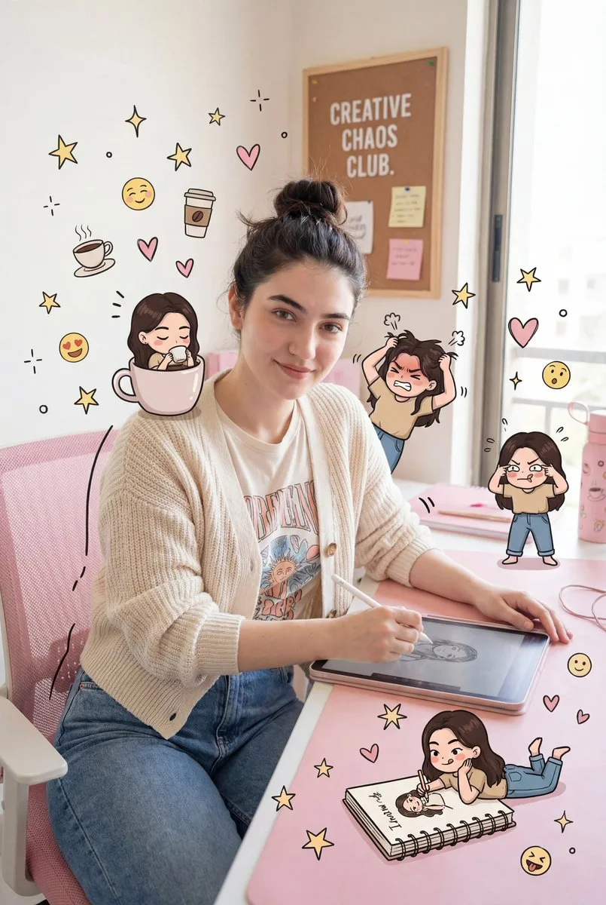

# Zara — by @ZaraIrahh

[← Back to Examples from X](../../EXAMPLES.md) · Category: Photography · Model: `Nano Banana`

<a href="https://x.com/ZaraIrahh/status/2045105124268478650"></a>

Original post: **[@ZaraIrahh on X](https://x.com/ZaraIrahh/status/2045105124268478650)** · Creator: [Zara](https://x.com/ZaraIrahh)

## Prompt

```text
Use the reference photo to create a realistic female character, soft smile, with a fun and natural expression, without changing the facial structure or features, keeping it as realistic as possible.
Hair: Same as in the reference photo, with natural movement and shine.
Outfit: Modern, stylish casual clothing.
Scene: Set in a cute pink office, showing her being creative. Around her, include mini chibi versions of herself doing funny actions (drinking coffee from a cup, pulling her hair, making silly faces, lying on her stomach on the desk drawing in a notebook). Add doodles and emojis, and include a matching phrase.
Lighting & Format: Natural light, aspect ratio 1080:1350 (4:5).
```

## Try it

Paste the prompt into **[vinano.ai](https://vinano.ai?utm_source=github&utm_medium=readme&utm_campaign=awesome-image-video-prompts-updating&utm_content=x-page-try)** to generate your own version.

> The image and prompt belong to [@ZaraIrahh](https://x.com/ZaraIrahh) and are shown here with credit for reference. Creators can ask for changes or removal by opening an issue.
