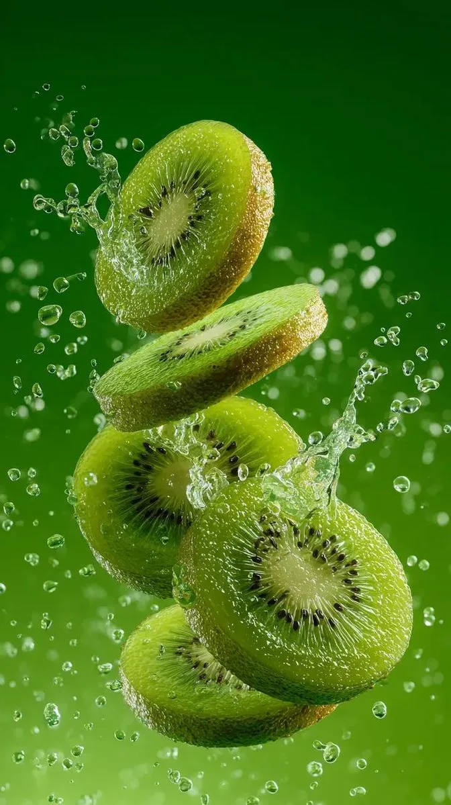

# 𝐌 — by @Strength04_X

[← Back to Community Examples](../../EXAMPLES.md) · Category: Food & Drink · Model: `Nano Banana`

<a href="https://x.com/Strength04_X/status/2016528524543488246"></a>

Source: **[@Strength04_X on X](https://x.com/Strength04_X/status/2016528524543488246)** · Creator: [𝐌](https://x.com/Strength04_X)

## Prompt

```text
A hyper-realistic image of a sliced kiwi splashing in a spray of water with droplets suspended in the air. Fresh kiwi slices, dynamically arranged in a floating composition, create a smooth green background. The smooth green gradient creates a fresh, bright, and juicy aesthetic. Studio lighting, soft shadows, high detail, macro photography of objects, an emphasis on texture and reflections. Ultra-realistic rendering, 8K, sharp focus, rich green tones. --ar 9:16 --raw
```

## Try it

Paste the prompt into **[vinano.ai](https://vinano.ai?utm_source=github&utm_medium=readme&utm_campaign=awesome-image-video-prompts-updating&utm_content=x-page-try)** to generate your own version.

> The image and prompt belong to @Strength04_X ([original post](https://x.com/Strength04_X/status/2016528524543488246)) and are shown here with credit for reference. Creators can ask for changes or removal by opening an issue.
