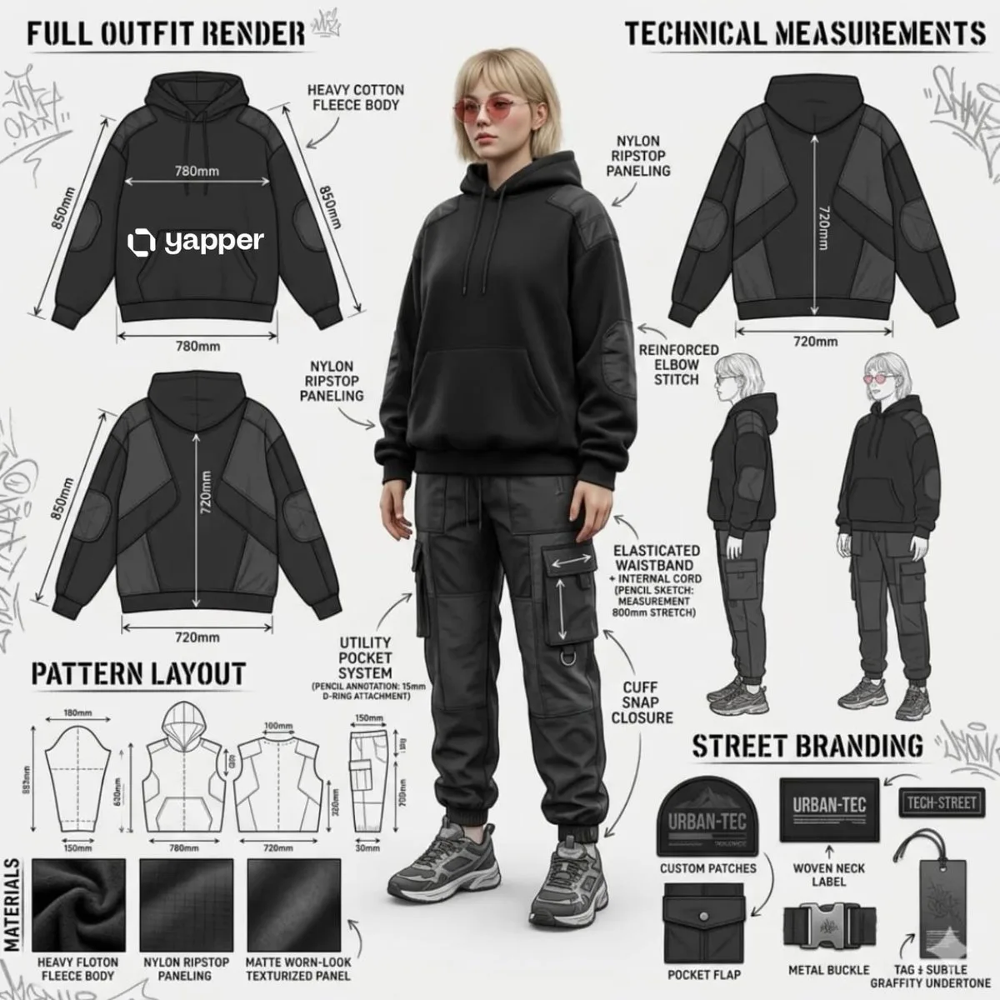

# simeon-sanai — by @Naiknelofar788

[← Back to Examples from X](../../EXAMPLES.md) · Category: Poster Design · Model: `Nano Banana`

<a href="https://x.com/Naiknelofar788/status/2038942399746212173"></a>

Original post: **[@Naiknelofar788 on X](https://x.com/Naiknelofar788/status/2038942399746212173)** · Creator: [simeon-sanai](https://x.com/Naiknelofar788)

## Prompt

```text
Using the attached image, create a professional industrial fashion design illustration sheet for a high-end streetwear outfit.
A centered heroic full-body 3D render of a modern urban look (oversized hoodie, cargo pants, sneakers), with realistic fabric physics, detailed stitching, and layered textiles. Soft studio lighting with subtle shadows and premium editorial finish.
Surround with technical views:
Front, back, side, 3/4 perspective
Flat lay pattern layout
Include sketches:
Panel segmentation (oversized cuts)
Stitching and seam details
Elastic waistband, cuffs, drawstrings
Measurement arrows in millimeters
Materials (handwritten notes):
Heavy cotton fleece, nylon, ripstop
Matte + slightly worn textures
Reinforced stress zones
Extras:
Street branding placement (logos, tags, patches)
Pocket systems and utility design
Style: Clean sketchbook + graffiti undertone, realistic + pencil hybrid, ultra-detailed.
```

## Try it

Paste the prompt into **[vinano.ai](https://vinano.ai?utm_source=github&utm_medium=readme&utm_campaign=awesome-image-video-prompts-updating&utm_content=x-page-try)** to generate your own version.

> The image and prompt belong to [@Naiknelofar788](https://x.com/Naiknelofar788) and are shown here with credit for reference. Creators can ask for changes or removal by opening an issue.
