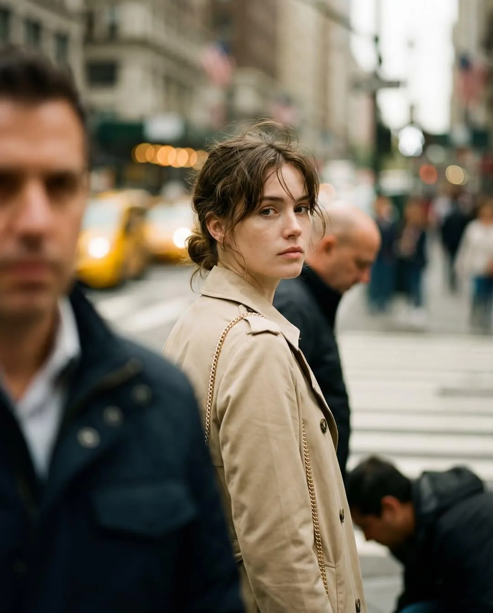

# Taaruk — by @Taaruk_

[← Back to Examples from X](../../EXAMPLES.md) · Category: Photography · Model: `Nano Banana`

<a href="https://x.com/Taaruk_/status/2008745209547669542"></a>

Original post: **[@Taaruk_ on X](https://x.com/Taaruk_/status/2008745209547669542)** · Creator: [Taaruk](https://x.com/Taaruk_)

## Prompt

```text
{
  "Objective": "Create a realistic candid street photograph with cinematic documentary realism",
  "PersonaDetails": {
    "Subject": {
      "Type": "Young woman",
      "Pose": "Standing at a city crosswalk, captured mid-turn",
      "Gaze": "Looking directly toward the camera",
      "Expression": "Calm, introspective, slightly distant",
      "Hair": "Loosely tied back with soft strands framing the face",
      "Wardrobe": {
        "Outerwear": "Beige trench coat",
        "Accessories": "Thin gold chain shoulder bag"
      }
    }
  },
  "SceneDescription": {
    "Location": "Busy urban crosswalk",
    "BackgroundElements": [
      "Pedestrians in motion",
      "Yellow taxis",
      "Tall city buildings"
    ],
    "Motion": "Subtle background movement suggesting city life"
  },
  "Composition": {
    "Framing": "Waist-up candid framing",
    "Moment": "Unposed, spontaneous mid-turn capture",
    "DepthOfField": "Shallow depth of field",
    "Focus": "Ultra-sharp subject with background motion blur"
  },
  "LightingAndColor": {
    "Lighting": "Natural overcast daylight",
    "ColorPalette": "Muted neutral tones",
    "Bokeh": "Soft cinematic bokeh"
  },
  "PhotographyStyle": {
    "Genre": "Street photography",
    "Aesthetic": "Documentary-style realism",
    "LensLook": "85mm lens perspective",
    "DetailLevel": "High detail, photorealistic textures"
  },
  "Mood": {
    "Tone": "Quiet, reflective, urban",
    "Atmosphere": "Authentic, lived-in city moment"
  },
  "ArtDirection": {
    "Style": "Photorealistic",
    "RealismLevel": "True-to-life, candid capture",
    "Processing": "Minimal, natural post-processing"
  },
  "NegativePrompt": [
    "posed look",
    "fashion editorial",
    "studio lighting",
    "oversaturated colors",
    "heavy retouching",
    "cartoon",
    "anime",
    "blurry subject"
  ],
  "ResponseFormat": {
    "Type": "Single image",
    "Orientation": "Portrait",
    "AspectRatio": "2:3"
  }
}
```

## Try it

Paste the prompt into **[vinano.ai](https://vinano.ai?utm_source=github&utm_medium=readme&utm_campaign=awesome-image-video-prompts-updating&utm_content=x-page-try)** to generate your own version.

> The image and prompt belong to [@Taaruk_](https://x.com/Taaruk_) and are shown here with credit for reference. Creators can ask for changes or removal by opening an issue.
