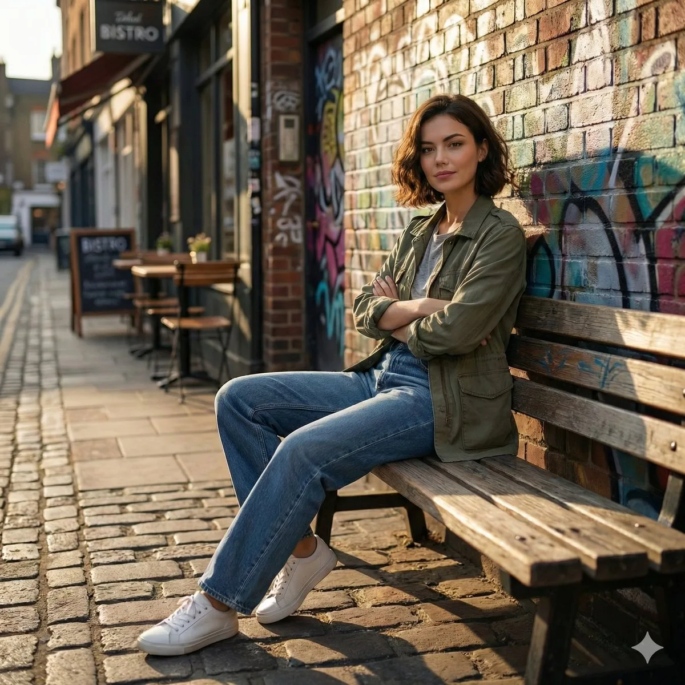

# simeon-sanai — by @Naiknelofar788

[← Back to Community Examples](../../EXAMPLES.md) · Category: Photography · Model: `Nano Banana`

<a href="https://x.com/Naiknelofar788/status/2017805744486396063"></a>

Source: **[@Naiknelofar788 on X](https://x.com/Naiknelofar788/status/2017805744486396063)** · Creator: [simeon-sanai](https://x.com/Naiknelofar788)

## Prompt

```text
Cinematic realistic street scene, beautiful young woman with short wavy bob haircut, natural hourglass body shape with correct human proportions, sitting relaxed on a wooden bench in front of a small restaurant, graffiti wall behind her, late afternoon side sunlight with strong shadows. Casual urban outfit: inner t-shirt with a light open outer jacket, relaxed denim pants, sneakers. Soft cinematic color grading, shallow depth of field, ultra-detailed, photorealistic
```

## Try it

Paste the prompt into **[vinano.ai](https://vinano.ai?utm_source=github&utm_medium=readme&utm_campaign=awesome-image-video-prompts-updating&utm_content=x-page-try)** to generate your own version.

> The image and prompt belong to @Naiknelofar788 ([original post](https://x.com/Naiknelofar788/status/2017805744486396063)) and are shown here with credit for reference. Creators can ask for changes or removal by opening an issue.
