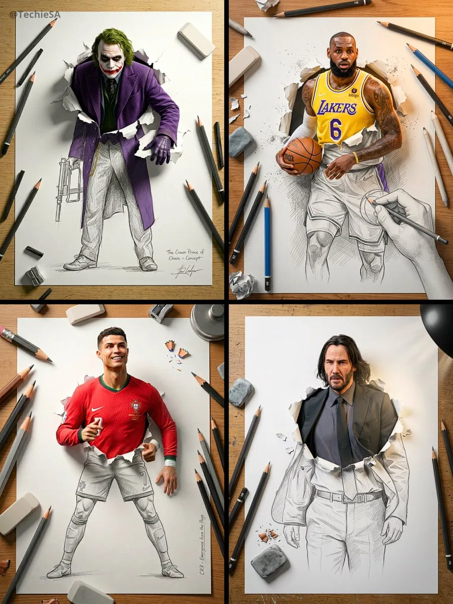

# TechieSA — by @TechieBySA

[← Back to Community Examples](../../EXAMPLES.md) · Category: Illustration & 3D · Model: `Nano Banana`

<a href="https://x.com/TechieBySA/status/2036909125347553519"></a>

Source: **[@TechieBySA on X](https://x.com/TechieBySA/status/2036909125347553519)** · Creator: [TechieSA](https://x.com/TechieBySA)

## Prompt

```text
A stunning Trompe L’oeil 3D composition, where the subject—using an uploaded face as reference—appears to physically tear through a clean white drawing paper and emerge from a graphite sketch into the real world. The subject’s upper body is fully rendered in hyper-realistic color and texture, wearing the same clothes from the uploaded image, while the lower body remains a 2D pencil sketch on paper. Shot from an aerial (top-down) perspective using a 24mm lens to capture the entire drawing desk environment, including oversized pencils and erasers scattered around. The lighting is a blend of flat studio light for the paper area and dramatic side lighting with volumetric effects for the emerging 3D figure, casting realistic shadows that fall back onto the sketch area. 8K resolution, ray tracing, and advanced shading techniques are used to blur the boundary between illustration and reality in this extraordinary surrealist piece.
```

## Try it

Paste the prompt into **[vinano.ai](https://vinano.ai?utm_source=github&utm_medium=readme&utm_campaign=awesome-image-video-prompts-updating&utm_content=x-page-try)** to generate your own version.

> The image and prompt belong to @TechieBySA ([original post](https://x.com/TechieBySA/status/2036909125347553519)) and are shown here with credit for reference. Creators can ask for changes or removal by opening an issue.
