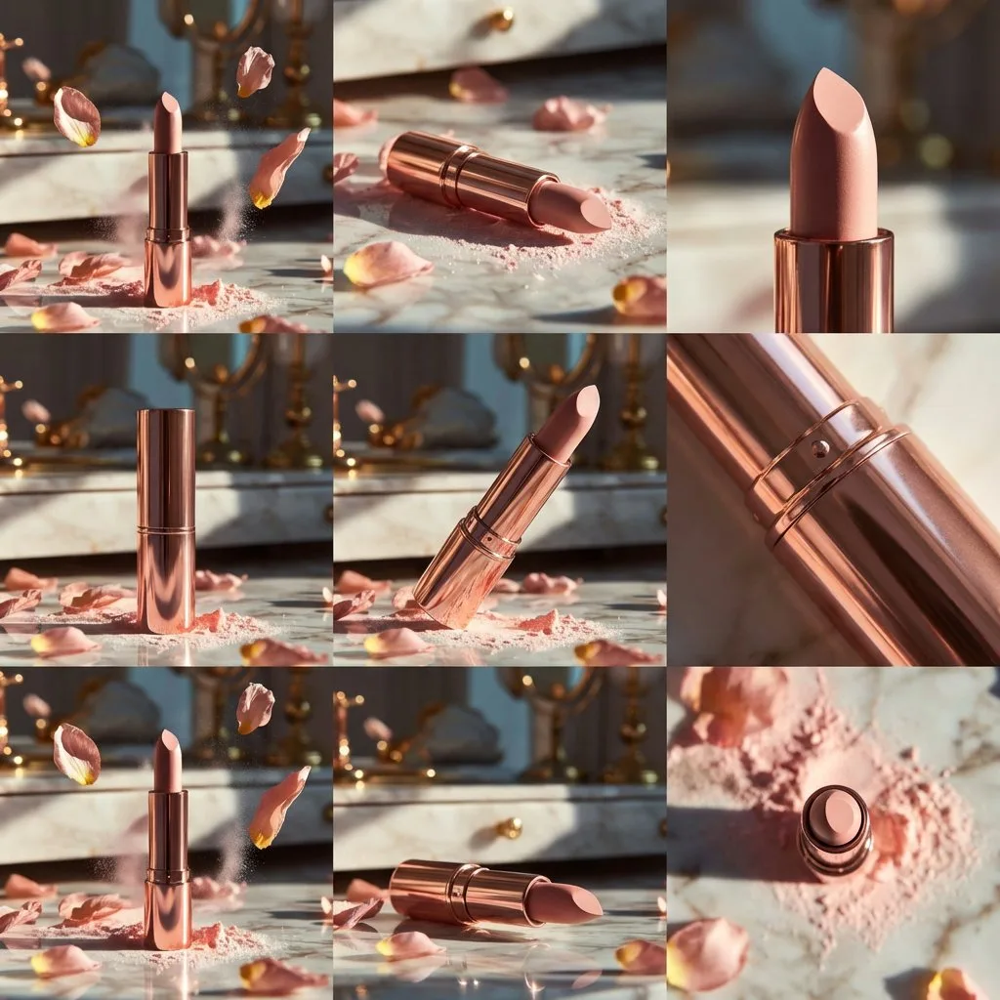

# Sharon Riley — by @Just_sharon7

[← Back to Examples from X](../../EXAMPLES.md) · Category: Product & Brand · Model: `Nano Banana`

<a href="https://x.com/Just_sharon7/status/2015812732977824176"></a>

Original post: **[@Just_sharon7 on X](https://x.com/Just_sharon7/status/2015812732977824176)** · Creator: [Sharon Riley](https://x.com/Just_sharon7)

## Prompt

```text
Elegant rose-gold lipstick standing upright on a reflective marble surface, surrounded by flying rose petals and soft powder dust. Warm studio lighting with dramatic shadows, luxury vanity background with blurred mirrors and golden accents, cinematic mood, macro product photography, ultra-sharp details, glossy textures, premium cosmetic brand style.

3×3photo grid with different angles and poses. Same character, consistent look, clean lighting, real photoshoot vibe 2k.
```

## Try it

Paste the prompt into **[vinano.ai](https://vinano.ai?utm_source=github&utm_medium=readme&utm_campaign=awesome-image-video-prompts-updating&utm_content=x-page-try)** to generate your own version.

> The image and prompt belong to [@Just_sharon7](https://x.com/Just_sharon7) and are shown here with credit for reference. Creators can ask for changes or removal by opening an issue.
