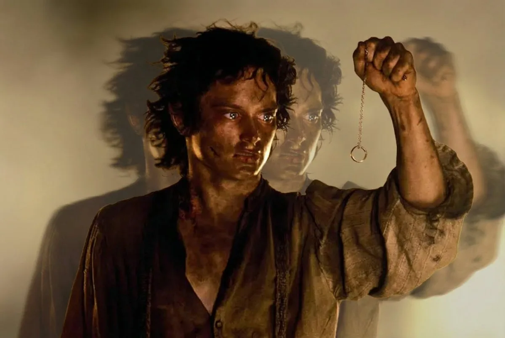

# Ege — by @egeberkina

[← Back to Examples from X](../../EXAMPLES.md) · Category: Photography · Model: `Nano Banana`

<a href="https://x.com/egeberkina/status/2020075837723193776"></a>

Original post: **[@egeberkina on X](https://x.com/egeberkina/status/2020075837723193776)** · Creator: [Ege](https://x.com/egeberkina)

## Prompt

```text
{
 "task": "temporal_motion_echo_portrait_effect",
 "input": {
 "source_image": "USER_UPLOADED_IMAGE",
 "preserve_identity": true,
 "preserve_pose": true,
 "preserve_outfit": true,
 "preserve_composition": true
 },
 "output": {
 "type": "single_image",
 "resolution": "ultra_high_resolution",
 "detail_preservation": "high",
 "ai_artifacts": "none"
 },
 "effect_design": {
 "core_effect": "motion_echo_time_displacement",
 "echo_direction": "horizontal",
 "echo_behavior": {
 "center_subject": "sharp_and_fully_in_focus",
 "echo_layers": "multiple_time_offset_duplicates",
 "blur_progression": "increasing_blur_with_distance_from_center",
 "opacity_falloff": "soft_fade_outward",
 "alignment": "perfectly_registered_with_original_subject"
 },
 "motion_style": {
 "type": "temporal_smear",
 "speed_feel": "slow_motion_time_stretch",
 "distortion": "none"
 }
 },
 "visual_style": {
 "background": {
 "treatment": "smooth_minimal_gradient",
 "blur": "subtle",
 "color_continuity": "match_original_background"
 },
 "lighting": {
 "preserve_original_lighting": true,
 "contrast": "controlled",
 "highlights": "soft",
 "shadows": "clean"
 },
 "color": {
 "grade": "cinematic_muted",
 "saturation": "natural",
 "skin_tones": "accurate"
 }
 },
 "restrictions": {
 "no_new_elements": true,
 "no_pose_change": true,
 "no_face_warping": true,
 "no_outfit_modification": true,
 "no_background_replacement": true
 }
}
```

## Try it

Paste the prompt into **[vinano.ai](https://vinano.ai?utm_source=github&utm_medium=readme&utm_campaign=awesome-image-video-prompts-updating&utm_content=x-page-try)** to generate your own version.

> The image and prompt belong to [@egeberkina](https://x.com/egeberkina) and are shown here with credit for reference. Creators can ask for changes or removal by opening an issue.
