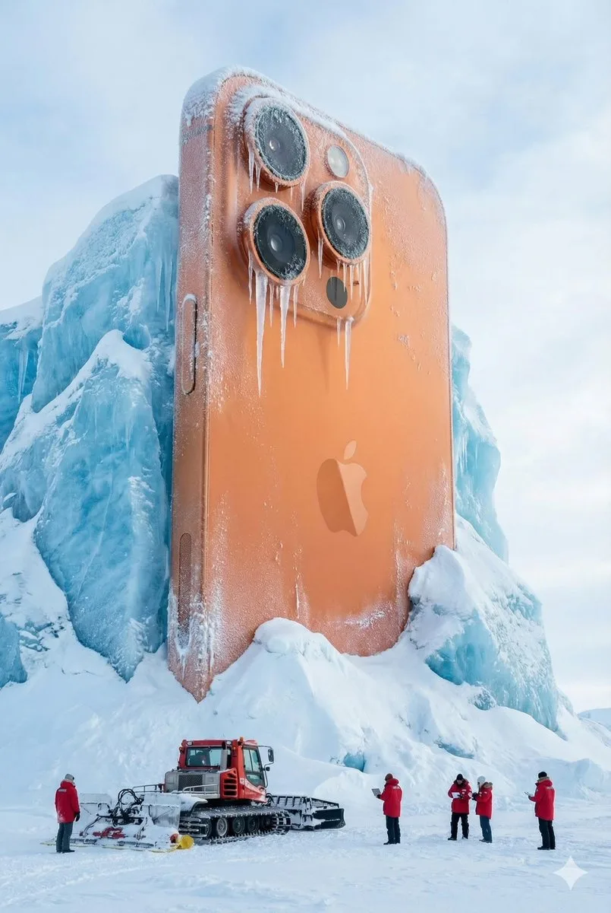

# Duet | AI — by @Sheldon056

[← Back to Community Examples](../../EXAMPLES.md) · Category: Product & Brand · Model: `Nano Banana`

<a href="https://x.com/Sheldon056/status/2028261430064185366"></a>

Source: **[@Sheldon056 on X](https://x.com/Sheldon056/status/2028261430064185366)** · Creator: [Duet | AI](https://x.com/Sheldon056)

## Prompt

```text
Hyper-realistic 8k cinematic photograph, low-angle wide lens. A giant Coca-Cola can standing like a monument, partially encased in thick blue glacial ice and snow in an arctic landscape. Frost covering the aluminum surface, long icicles hanging from the rim, snow filling the top opening. Snowcat vehicle and scientists in red parkas for scale. Cold diffused lighting, HDR, ultra-real frozen textures, cinematic atmosphere --ar 2:3
```

## Try it

Paste the prompt into **[vinano.ai](https://vinano.ai?utm_source=github&utm_medium=readme&utm_campaign=awesome-image-video-prompts-updating&utm_content=x-page-try)** to generate your own version.

> The image and prompt belong to @Sheldon056 ([original post](https://x.com/Sheldon056/status/2028261430064185366)) and are shown here with credit for reference. Creators can ask for changes or removal by opening an issue.
