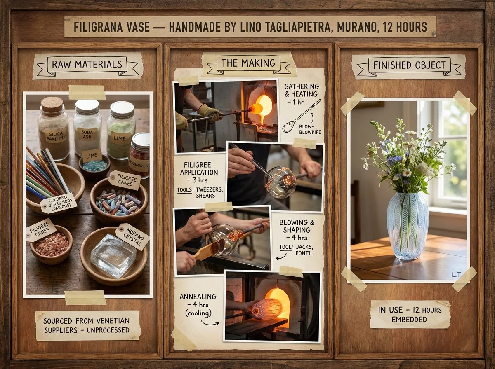

# Alexandra Aisling — by @AllaAisling

[← Back to Community Examples](../../EXAMPLES.md) · Category: Illustration & 3D · Model: `Nano Banana`

<a href="https://x.com/AllaAisling/status/2012197160276660362"></a>

Source: **[@AllaAisling on X](https://x.com/AllaAisling/status/2012197160276660362)** · Creator: [Alexandra Aisling](https://x.com/AllaAisling)

## Prompt

```text
An artisan's method board for [HANDMADE OBJECT] — [TECHNIQUE / TRADITION / ORIGIN]. Left section: raw materials in unprocessed state, sourced and labeled, the transformation yet to begin. Center section: the making documented in sequential stages, hands visible throughout, tools identified, key decision points annotated, time invested at each phase noted. Right section: the finished object in use context, bearing the maker's mark, fulfilling its purpose, the hours invisible but embedded. Visual style transitions from raw material earth tones through workshop warmth to lifestyle context with natural light. Title block reading "[OBJECT NAME] — HANDMADE BY [MAKER], [LOCATION], [HOURS] HOURS".
```

## Try it

Paste the prompt into **[vinano.ai](https://vinano.ai?utm_source=github&utm_medium=readme&utm_campaign=awesome-image-video-prompts-updating&utm_content=x-page-try)** to generate your own version.

> The image and prompt belong to @AllaAisling ([original post](https://x.com/AllaAisling/status/2012197160276660362)) and are shown here with credit for reference. Creators can ask for changes or removal by opening an issue.
